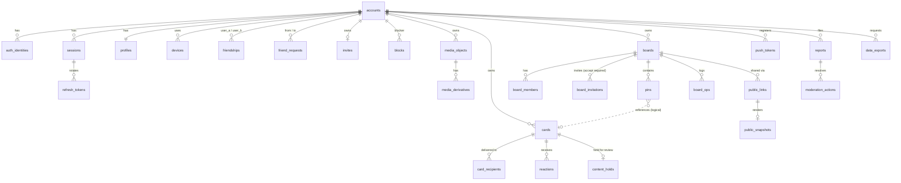

# Data model (MVP)
**TL;DR:** PostgreSQL 16+, one **schema per module** (`identity`, `social`, `media`, `cards`, `boards`, `feed`, `sharing`,
`notifications`, `moderation`, `privacy`, `platform`). UUIDv7 PKs, `TIMESTAMPTZ`, `NOT NULL` by default, every user-owned row
carries an ownership column. Only `identity.accounts(id)` may be referenced by FK from other schemas (hard-delete safety net);
all other cross-module references are logical ids resolved through service traits ([[overview]] §3).

## Conventions
- PK `id UUID` (UUIDv7, generated server-side unless noted "client-generated" for offline creation — then validated as v7 and
  scoped by owner). `created_at/updated_at TIMESTAMPTZ NOT NULL DEFAULT now()`.
- Enums = `TEXT` + `CHECK` (cheap to extend via migration, unlike PG enums). Registry refs (cut style, finish, effect, backdrop,
  decoration) stored as `{id, version}` JSON per [[effects-catalog]] — never FKs, so registry changes are data migrations.
- Secrets/tokens stored only as SHA-256 hashes. `enc` = application-level AEAD (key in secret manager) on top of disk encryption.
- Every SQL statement lives in the owning crate and is scoped by owner/member in the `WHERE` clause ([[security-baseline]] §3).
- Classification: **S** secret · **P** PII · **I** internal · **U** public-by-design (shown to guests/strangers).

## ER diagram (core)

## Tables
### `identity` (owner: identity)
| Table | Columns (type, constraint) | Indexes | Class | Retention |
|---|---|---|---|---|
| `accounts` | `id`; `status TEXT CHECK in (pending_age, pending_profile, active, suspended, banned, deletion_pending)`; `birth_date_enc BYTEA NULL` (set only when age gate passed); `region_signals JSONB` (store/declared country, last IP country); `suspended_until`; `deletion_requested_at` | `status` partial where not active | P (DOB enc) | Hard-deleted ≤ 30 d after deletion |
| `auth_identities` | `id`; `account_id FK accounts ON DELETE CASCADE`; `provider CHECK (apple, google, email)`; `subject TEXT` (Apple/Google `sub`, or email hash); `email CITEXT NULL`; `apple_refresh_token_enc BYTEA NULL` (needed for Apple revoke on deletion) | `UNIQUE(provider, subject)`; `(account_id)` | P, S | With account |
| `magic_links` | `id`; `email_hash BYTEA`; `token_hash BYTEA UNIQUE` (256-bit raw token); `pkce_challenge BYTEA` (device-bound verifier); `expires_at` (15 min); `used_at` (single use; set only by the in-app confirm, never by a GET, AC-1.3) | `(email_hash, created_at)` | S | 24 h |
| `sessions` | One row per device sign-in (= refresh-token family). `id`; `account_id FK CASCADE`; `access_token_hash BYTEA UNIQUE` (opaque, 10 min); `access_expires_at`; `scope CHECK (onboarding, full, widget, reauth, staff)`; `parent_session_id UUID NULL` (widget/reauth tokens die with their device session); `device_id NULL`; `client_label TEXT` (platform + app version, for the session list); `ip_country`; `idle_expires_at` (60 d); `absolute_expires_at` (180 d); `last_seen_at`; `revoked_at`; `revoked_reason CHECK (logout, logout_all, refresh_reuse, suspended, deleted, staff) NULL`; `mfa_at NULL` | `(account_id) WHERE revoked_at IS NULL`; `(parent_session_id)` | S | 30 d after expiry |
| `refresh_tokens` | `token_hash BYTEA PK`; `session_id` (same-schema FK CASCADE); `generation INT`; `issued_at`; `consumed_at NULL`. Presenting a consumed token = reuse ⇒ the whole session family is revoked (`refresh_reuse`) and the user is alerted (AC-1.4) | `(session_id, generation)` | S | With session |
| `profiles` | `account_id PK FK CASCADE`; `display_name TEXT CHECK len 2–30`; `avatar_media_id UUID NULL`; `handle CITEXT UNIQUE CHECK ~ '^[a-z0-9._]{3,20}$'`; `handle_changed_at`; `findable_by_handle BOOL DEFAULT true` (only effective at or above `discovery.min_age`; minors cannot turn it on) | `UNIQUE(handle)` | U (name, avatar, handle) | With account |
| `handle_reservations` | `handle CITEXT PK`; `released_by UUID`; `reserved_until` (30 d) | `(reserved_until)` | I | Until expiry |
| `devices` | `id` (client-generated); `account_id FK CASCADE`; `platform CHECK (ios, android)`; `app_version`; `attest_key_id NULL`; `last_seen_at` | `(account_id)` | I | 90 d inactive |
| `staff_members` | `account_id PK FK`; `role CHECK (moderator, admin)`; `mfa_secret_enc` / `webauthn_credentials JSONB`; `disabled_at` | — | S | Employment + 2 y |

Implementation notes (T-18, `migrations/20261105000001_identity_init.sql`): migrations live in `migrations/` at the repo root,
named `<timestamp>_<module>_<description>.sql`, applied by `api migrate`; each file touches only its module's schema and revokes
`anon`/`authenticated` (Supabase) on it. `devices` uses PK `(account_id, id)` because device ids are client-generated (two accounts
can share a phone). `auth_identities.email` is `TEXT` (no `citext` extension; never used for lookups or linking). `region_signals` =
`{"store": "US", "ip": "DE", "declared": "US"}` (ISO alpha-2, each optional). A session's `scope` is `onboarding` until the account
is `active`; authorization also checks the account status, and status changes evict the account's cached sessions.

Profiles (T-31, `migrations/20261106000001_identity_profiles.sql`): one row per account, created by the first profile write;
`display_name TEXT NULL` (sanitized by `platform::text`; the CHECK is a storage bound of 480 code points = 30 clusters × 16,
the grapheme rule lives in the app). `avatar_media_id` is added by the media ticket. `findable_by_handle BOOL NOT NULL DEFAULT true` was added by T-45
(`20261109000004_identity_findable.sql`); minors cannot turn it on, and search ignores it below `discovery.min_age` anyway.
Handles (T-32, `migrations/20261106000002_identity_handles.sql`): `handle TEXT UNIQUE` (stored lowercase instead of CITEXT, same
case-insensitive uniqueness), `handle_claimed_at` (first claim, starts the 24 h free-change grace window, never reset) and
`handle_changed_at` (cooldown base); `handle_reservations(handle PK, released_by, reserved_until)` without FK so a reservation
outlives a deleted account. Expired reservations are deleted lazily on the next claim (no cleanup job yet).

Minor status (T-29, `migrations/20261108000001_identity_os_age_signal.sql`): `accounts.os_age_signal TEXT NULL CHECK (minor,
adult)`, `os_age_signal_source CHECK (apple_declared_age_range, google_play_age_signals)`, `os_age_signal_at` (all set together;
written only while `API_OS_AGE_SIGNALS_ENABLED`). `AgeService` caches the per-day inputs (age in years, stored region signals,
minor signal) in Redis as `age:<account>:<YYYY-MM-DD>` for ≤ 24 h — the date in the key makes a birthday apply the next day;
a new signal evicts the entry. The DOB itself never leaves Postgres unencrypted.

Attestation (T-35, `migrations/20261108000002_identity_attestation_keys.sql`): `attestation_keys(key_id TEXT PK` =
`ios:<App Attest key id>` or `android:<account>:<device>`; `account_id FK CASCADE`; `device_id`; `platform`; `public_key BYTEA(65)
NULL` (set when a key attestation passed); `sign_count` (last assertion counter, compare-and-set); `pass_count`, `fail_count`,
`last_verdict`, `last_failure` (reason code), `last_verdict_at)`. A row belongs to one account; other accounts' checks never touch
it. `devices.attest_key_id` is set on registration. Challenges live in Redis only: `att:ch:<sha256(challenge)>` → account id,
5 min, `GETDEL` on use.

Magic links (T-22, `migrations/20261108000003_identity_magic_links.sql`): `magic_links(id, email_hash BYTEA(32)` (SHA-256 of the
trimmed, lowercased email), `token_hash UNIQUE`, `pkce_challenge BYTEA(32)` (S256), `delivery_enc BYTEA NULL` (the address and the raw link secret, sealed with XChaCha20-Poly1305 bound to the link id;
cleared by the delivery job), `sent_at`, `expires_at` (15 min), `used_at`
(T-23), `created_at)`; purged after 24 h by the worker. Indexes `(email_hash, created_at)`, `(created_at)`.

Age-gate refusal stores **nothing** in Postgres: the pending account is deleted and a 24 h cooldown key
`agegate:{sha256(device_id)}` / `agegate:{sha256(provider:subject)}` lives in Redis only (AC-2.1). Implemented (T-28) as
`agegate:d:<hex>` and `agegate:i:<hex>`; `birth_date_enc` = XChaCha20-Poly1305 (`platform::crypto::FieldCipher`, key
`API_DATA_ENCRYPTION_KEY`, key id byte for rotation) with the account id as associated data, so a ciphertext copied to another row
fails to decrypt.

### `social` (owner: social)
| Table | Columns | Indexes | Class | Retention |
|---|---|---|---|---|
| `friendships` | `user_a UUID FK`, `user_b UUID FK` (canonical `user_a < user_b`, `CHECK`); `created_at`; PK `(user_a, user_b)` | `(user_b)` | I | Deleted on unfriend |
| `friend_requests` | `id`; `from_user FK`; `to_user FK`; `source CHECK (invite, search)`; `status CHECK (pending, accepted, declined, cancelled, expired, dropped)`; `expires_at` (14 d) | `UNIQUE(from_user,to_user) WHERE status='pending'`; `(to_user, status, created_at DESC)`; `(from_user, created_at)` | I | 30 d after terminal |
| `invites` | `owner_id PK FK`; `token_hash BYTEA UNIQUE`; `created_at`; `rotated_at`; `expires_at NULL` (+7 d when the owner is under 18, `invites.minor_ttl`); `max_uses INT NULL` (minors: `invites.minor_max_uses`); `use_count INT DEFAULT 0` (incremented in the friend-request tx; at cap or past expiry ⇒ `INVITE_EXPIRED`, AC-4.4) | — | S | Replaced on reset |
| `blocks` | `blocker_id FK`, `blocked_id FK`, PK both; `created_at` | `(blocked_id)` | I | Until unblock / deletion |

Invites as implemented (T-37, `migrations/20261109000001_social_invites.sql`): `invites(id PK, owner_id FK CASCADE,
token_hash BYTEA UNIQUE (SHA-256), token_enc BYTEA, created_at, revoked_at NULL)` with one live row per owner (partial UNIQUE
`(owner_id) WHERE revoked_at IS NULL`). A reset revokes the live row and inserts a new one, so an old token is recognised and
answers `INVITE_EXPIRED` instead of a plain 404. `token_enc` = the raw token encrypted with the field cipher (associated data =
owner id) so `GET /v1/me/invite` can return the same link again; lookups only ever use the hash. T-38
(`20261109000002_social_invite_limits.sql`) adds `expires_at NULL`, `max_uses INT NULL` and `use_count INT DEFAULT 0`: set
from region policy when the owner is a minor at issue time; on every use the tighter of the stored limits and the current minor
rule (from issue time) applies.

Requests, friendships and blocks as implemented (T-39, `20261109000003_social_friend_requests.sql`): `friend_requests` adds
`created_at` and `responded_at`; a request is **open** while `pending`, `declined` or `dropped` and unexpired, because declines and
drops are silent (the sender sees "pending" until expiry, and it keeps its slot under the sender's pending cap). The pair dedupe
index is `UNIQUE(from_user, to_user) WHERE status IN ('pending','declined','dropped')`; only `pending` rows reach the recipient.
`friendships` and `blocks` as above, with `CHECK` against self-edges. Pair writes take `pg_advisory_xact_lock` on both accounts
(key = the random tail of the UUIDv7, locked in key order). Retention (T-41): the `social.expire_requests` worker task marks
open requests past `expires_at` as `expired`, deletes `accepted` / `cancelled` / `expired` rows 30 days after they were answered
or expired, and deletes revoked invites 30 days after the reset (`requests.retention_days`).

The "adult · no mutual friends" hint on a minor's incoming request (AC-5.5) is computed at read time (recipient is a minor ∧
sender is an adult ∧ no mutual friends); nothing extra is stored. Minor status always comes from
`identity::AgeService::is_minor(ids)` (decrypts DOB, Redis cache 24 h), never from a client flag.

Friend cap (20) and pending cap (20) are race-safe: in one transaction take `pg_advisory_xact_lock` on both user ids (sorted,
to avoid deadlocks), count, then insert (AC-5.2). Caps come from `PolicyService`/config, not constants.

### `media` (owner: media)
| Table | Columns | Indexes | Class | Retention |
|---|---|---|---|---|
| `media_objects` | `id`; `owner_id FK CASCADE`; `kind CHECK (card_render, mask, original, avatar)`; `state CHECK (uploaded, scanning, clean, held, blocked, deleted)` (`held` = nudity classifier flag: stays in `quarantine`, signed only for the owner); `storage_key TEXT UNIQUE` (random, no user data); `bucket CHECK (quarantine, clean, legal_hold)`; `content_type`; `byte_size INT CHECK ≤ 10 MB`; `width`,`height`; `sha256 BYTEA`; `scan_provider_ref NULL`; `scanned_at`; `classifier_score REAL NULL`; `classifier_model TEXT NULL` | `UNIQUE(owner_id, sha256, kind)` (upload dedupe); `(state) WHERE state IN ('uploaded','scanning')` | P (image content) | Deleted 24 h after referencing card deleted; unreferenced uploads 48 h |
| `media_derivatives` | `id`; `media_id` (same-schema FK CASCADE); `variant CHECK (feed_1080, widget_512, thumb_256, public_wm, og)`; `scope_id UUID NULL` (public link id for watermarked variants); `storage_key UNIQUE` | `UNIQUE(media_id, variant, scope_id)` | P / U for `public_wm`, `og` | With parent / link |

Originals (`kind=original`) get no recipient derivatives and are signed only for their owner (AC-13.6); recipients only ever receive
`feed_1080` / `widget_512` / `thumb_256`. The `og` variant is a watermarked composite of the owner's card pins (AC-24.7), keyed by
link id; it is deleted and purged on revoke, but copies already fetched by social crawlers are outside our control (accepted risk D4).

### `cards` (owner: cards)
| Table | Columns | Indexes | Class | Retention |
|---|---|---|---|---|
| `cards` | `id`; `owner_id FK CASCADE`; `client_card_id UUID` (outbox idempotency); `status CHECK (pending_scan, held_review, active, blocked, deleted)` (`held_review` = nudity classifier flag, AC-28.3: never delivered unless a moderator releases it); `render_media_id`, `mask_media_id UUID`; `original_media_id UUID NULL` (keep-original only); `style JSONB` (`{cut, finish, effects[]}` registry refs + params); `caption TEXT NULL CHECK len ≤ 80`; `alt_text TEXT NULL`; `audience_mode CHECK (all, subset)`; `schema_version SMALLINT`; `sent_at`; `deleted_at` | `UNIQUE(owner_id, client_card_id)`; `(owner_id, created_at DESC)` | P (caption) | Row soft-deleted → hard delete after 30 d |
| `card_recipients` | `card_id` (FK cards CASCADE), `recipient_id FK accounts CASCADE`, PK both; `sender_id UUID` (denormalized for feed filter); `delivered_at NULL` (set after scan); `hidden_at NULL` | `(recipient_id, delivered_at DESC, card_id) WHERE delivered_at IS NOT NULL AND hidden_at IS NULL` | I | With card |
| `reactions` | `card_id`, `reactor_id`, PK both; `kind TEXT` (registry id, e.g. `react.heart`, `react.squish`); `updated_at` | `(card_id)` | I | With card |

### `boards` (owner: boards) — sync semantics in [[ADR-0007-board-sync]]
| Table | Columns | Indexes | Class | Retention |
|---|---|---|---|---|
| `boards` | `id` (client-generated); `owner_id FK CASCADE`; `title TEXT CHECK len 1–60`; `backdrop JSONB` (registry ref); `version BIGINT` (bumped on every change, change cursor); `schema_version`; `deleted_at` | `(owner_id) WHERE deleted_at IS NULL` | P (title) | Hard delete 30 d after delete |
| `board_members` | `board_id FK CASCADE`, `user_id FK accounts CASCADE`, PK both; `role CHECK (owner, collaborator)`; `invitation_id UUID NULL` (collaborators join only by accepting one); `created_at` | `(user_id)` | I | Removed on leave/removal/block |
| `board_invitations` | `id`; `board_id FK CASCADE`; `inviter_id UUID` (= owner); `invitee_id FK accounts CASCADE`; `status CHECK (pending, accepted, declined, cancelled, expired, dropped)`; `expires_at` (7 d, `boards.invitation_ttl`); `responded_at NULL` | `UNIQUE(board_id, invitee_id) WHERE status='pending'`; `(invitee_id, status, created_at DESC)`; `(board_id) WHERE status='pending'` | I | 30 d after terminal |
| `pins` | `id` (client-generated UUIDv7); `board_id FK CASCADE`; `created_by UUID`; `kind CHECK (card, decoration)`; `card_id UUID NULL` (logical ref); `decoration JSONB NULL`; `x, y REAL` (board units), `scale REAL CHECK 0.1–10`, `rotation REAL`; `z_key TEXT` (fractional index); `version BIGINT`; `changed_at_board_version BIGINT`; `updated_by`; `deleted_at` (tombstone for sync); `CHECK ((kind='card') = (card_id IS NOT NULL))` | `(board_id, changed_at_board_version)`; `(card_id)` (card-delete fan-out); `(board_id) WHERE deleted_at IS NULL` | I | Tombstones purged 30 d |
| `board_ops` | `board_id FK CASCADE`; `seq BIGINT` (= board version); `op_id UUID UNIQUE` (client idempotency); `actor_id`; `op JSONB`; `created_at`; PK `(board_id, seq)` | `UNIQUE(op_id)` | I | 30 d (Phase 2: Yjs update log) |

Board invitation rules (AC-19.1, AC-19.8): the invitee must be the owner's current friend at invite **and** at accept; members +
pending invitations ≤ 8 (`boards.max_collaborators`), counted under `pg_advisory_xact_lock(board_id)`; ≤ 30 invitations per owner
per day; re-inviting the same user to the same board waits `boards.reinvite_cooldown` (7 d) after a decline. Declines are silent: the
owner sees the invitation as pending until `expires_at`, and it keeps its cap slot until then. If the invitee and any current member
have a block either way, the invitation is stored as `dropped` (same response to the owner, nothing shown to the invitee); accept
re-checks friendship, blocks and the cap in the same tx. A new block between two members resolves silently: the blocker leaves,
unless the blocker is the owner, in which case the blocked collaborator is removed (their pins removed, AC-19.6); pending
invitations between them are cancelled.

### `sharing` (owner: sharing)
| Table | Columns | Indexes | Class | Retention |
|---|---|---|---|---|
| `public_links` | `id`; `board_id UUID`; `owner_id FK CASCADE`; `token_hash BYTEA UNIQUE`; `expires_at NULL`; `revoked_at NULL`; `revoked_reason CHECK (owner, moderator, anomaly, board_deleted, owner_ineligible)`; `view_count BIGINT` | `(board_id) WHERE revoked_at IS NULL` | S (token hash), U (content) | 90 d after revoke |
| `public_snapshots` | `link_id PK` (same-schema FK CASCADE); `board_version BIGINT`; `snapshot JSONB` (owner pins + private tiles, no friend data); `og_media_id` (watermarked board snapshot, AC-24.7); `built_at` | — | U | With link |

### `feed`, `notifications`, `moderation`, `privacy`, `platform`
| Table (schema) | Columns | Indexes | Class | Retention |
|---|---|---|---|---|
| `activity_items` (feed) | `id`; `user_id FK CASCADE`; `type CHECK (card_new, card_held, card_released, reaction, friend_request, friend_accepted, board_invite, board_joined, new_login)`; `actor_id`; `subject_id`; `read_at` | `(user_id, created_at DESC)` | I | 90 d |
| `push_tokens` (notifications) | `id`; `user_id FK CASCADE`; `device_id`; `provider CHECK (apns, fcm)`; `kind CHECK (alert, widget)`; `token_enc BYTEA`; `token_hash UNIQUE`; `invalidated_at` | `(user_id) WHERE invalidated_at IS NULL` | S | Pruned on invalid / logout |
| `notification_prefs` (notifications) | `user_id PK FK CASCADE`; `card_new, reaction, friend, board BOOL`; `quiet_start, quiet_end TIME`; `tz TEXT` | — | I | With account |
| `reports` (moderation) | `id`; `source CHECK (user, guest, appeal)`; `hold_id UUID NULL` (appeals); `reporter_id UUID NULL` (guest = null); `reporter_ip_hash BYTEA NULL`; `target_type CHECK (card, board, public_link, user)`; `target_id`; `target_owner_id`; `reason CHECK (sexual, minor_safety, harassment, violence, hate, spam, other)`; `note TEXT ≤ 500`; `priority SMALLINT`; `status CHECK (open, in_review, actioned, dismissed)`; `assigned_to` | `(status, priority DESC, created_at)` | P | 2 y (legal review) |
| `content_holds` (moderation) | `id`; `card_id UUID UNIQUE`; `owner_id`; `media_id`; `classifier_model`; `score REAL`; `status CHECK (held, appealed, released, upheld, expired)`; `appeal_note TEXT NULL ≤ 500`; `appealed_at NULL`; `decided_by NULL`; `decided_at NULL`; `expires_at` (30 d without appeal ⇒ card deleted) | `(status, created_at)`; `(owner_id)` | P | 2 y (legal review) |
| `moderation_actions` (moderation) | `id`; `report_id NULL`; `hold_id NULL`; `actor_id`; `action CHECK (dismiss, remove_content, revoke_link, warn, suspend, ban, release_hold, uphold_hold)`; `target_type`, `target_id`; `reason`; `until NULL` — append-only | `(target_type, target_id)` | I | 2 y |
| `csam_incidents` (moderation) | `id`; `account_id` (no FK — survives deletion); `media_id`; `matched_at`; `provider_ref`; `evidence_key` (legal-hold bucket); `report_ref`; `reported_at` | `(reported_at) WHERE reported_at IS NULL` | S | Legal hold (≥ 1 y, counsel to confirm) |
| `data_exports` (privacy) | `id`; `user_id FK CASCADE`; `status CHECK (queued, building, ready, expired, failed)`; `storage_key NULL`; `ready_at`; `expires_at` (24 h) | `(user_id, created_at DESC)` | P | Files 24 h, rows 30 d |
| `deletion_requests` (privacy) | `user_id PK` (no FK); `requested_at`; `grace_until` (+7 d); `status CHECK (pending, cancelled, erasing, done)`; `steps JSONB` (per-module progress) | `(status, grace_until)` | I | Tombstone kept 1 y (replay after backup restore) |
| `outbox_events` (platform) | `id BIGINT IDENTITY`; `topic` (`module.event`); `payload JSONB` (ids and codes only, validated, ≤ 8 KiB); `trace_id`; `created_at`; `published_at` (T-16) | `(topic, id) WHERE published_at IS NULL`; `(published_at) WHERE published_at IS NOT NULL` | I | 7 d after publish |
| `jobs` (platform) | `id`; `queue CHECK (critical, default, bulk)`; `kind`; `unique_key UNIQUE NULL`; `payload JSONB` (ids only); `run_at`; `attempts`; `max_attempts`; `locked_by`, `locked_until` (set iff running); `last_error ≤ 2000`; `status CHECK (queued, running, done, dead)`; `created_at`; `finished_at` (T-15) | `(queue, run_at) WHERE status='queued'`; `(locked_until) WHERE status='running'`; `(status, finished_at) WHERE status IN ('done','dead')` | I | done 7 d, dead 30 d |
| `idempotency_keys` (platform) | `user_id`, `route`, `key UUID`, PK all; `request_hash BYTEA(32)`; `status_code NULL` (null while running); `response_content_type`, `response_body BYTEA ≤ 64 KiB`; `lease_id` (fencing token); `locked_until` (lease); `created_at` (T-14, `migrations/20261107000001_platform_idempotency.sql`) | `(created_at)` | I | 24 h |
| `audit_events` (platform) | `id`; `actor_id` (null for system); `actor_kind CHECK (user, staff, system)`; `action` (`module.verb`); `target` (`type:uuid`); `ip_hash` (keyed hash, not recorded yet); `details JSONB` (ids/codes only, outbox validator); `at` — append-only: role `app_rw` has INSERT/SELECT only (T-17) | `(target, at)`, `(actor_id, at)` | I | 2 y |

## Access patterns (from PRD stories)
| # | Query | Story | Frequency | Served by |
|---|---|---|---|---|
| 1 | Session lookup by access-token hash; refresh rotation by refresh-token hash | all | every request / ≤ 6/h per device | Redis → `sessions.access_token_hash`; `refresh_tokens` PK |
| 2 | Exact handle → account (+ hidden checks) | US-5a | ≤ 30/user/day | `profiles.handle` unique; `blocks` PK |
| 3 | Friend ids of user (≤ 20) | US-6, US-13, US-15 | very high | Redis set → `friendships` PK + `(user_b)` |
| 4 | Pending incoming requests | US-5 | medium | `friend_requests (to_user, status, created_at)` |
| 5 | Feed page: delivered to me from current friends, newest first, 30/page | US-15 | high | `card_recipients (recipient_id, delivered_at DESC)` + `sender_id = ANY($friends)` |
| 6 | Widget: latest delivered card (optionally one friend), re-validated on every refresh (AC-16.4) | US-16 | high (push-driven) | same index, `LIMIT 1` |
| 7 | Card visible to viewer? (owner / recipient & friend) | US-15, US-17 | high | `cards` PK + `card_recipients` PK + friend set |
| 8 | Insert card + recipients ∩ friends in one tx | US-13 | ~10/s peak | `UNIQUE(owner_id, client_card_id)` |
| 9 | Board with pins changed since version N, each card pin resolved per viewer (#7 + AC-19.7 + minor rule AC-19.9) | US-18, US-19 | medium | `pins (board_id, changed_at_board_version)` + batched `CardAccess::visible_to(viewer, card_ids)` + `AgeService::is_minor(member_ids)` + viewer's friend set |
| 10 | Conditional pin update by version | US-19 | medium | PK + `version` predicate |
| 11 | Boards I own or collaborate on | US-18, US-19 | medium | `board_members (user_id)` |
| 11a | My pending board invitations; pending count per board (cap) | US-19 AC-19.8 | low | `board_invitations (invitee_id, status, created_at DESC)`; `(board_id) WHERE status='pending'` |
| 12 | Pins referencing a deleted card | US-14 | low | `pins (card_id)` |
| 13 | Public link by token hash → snapshot | US-24 | spiky | `public_links.token_hash` → `public_snapshots` + Redis/CDN |
| 14 | Moderation queue by priority (user/guest reports + classifier appeals) | US-27, US-28 AC-28.3 | low | `reports (status, priority DESC, created_at)` |
| 15 | Next jobs to run | all async | continuous | `jobs (queue, run_at) WHERE status='queued'` + `FOR UPDATE SKIP LOCKED` |
| 16 | User's reactions on own card | US-17 | low | `reactions (card_id)` filtered by `cards.owner_id` |
| 17 | Everything owned by user X (export/erase) | US-29, US-30 | rare | `owner_id`/`user_id` indexes in each module |

## Data classification & handling
| Class | Examples | Handling |
|---|---|---|
| Secret | session/magic/invite/link token hashes, Apple refresh tokens, push tokens, MFA secrets, evidence keys | Hash or `enc`; never logged; never in responses except the one-time raw token at creation |
| PII | email, DOB, captions, board titles, card/mask/original images, report notes | Least-privilege access via owning module; exported (US-30) and erased (US-29); EXIF stripped |
| Internal | ids, graph edges, versions, jobs, audit | Not exposed beyond the caller's own data |
| Public-by-design | display name, handle, avatar, public snapshots, watermarked derivatives | Visible to friends/searchers/guests by product rule; still served via signed URLs |

## Deletion semantics
- **Card delete (US-14):** `cards.status=deleted` + `card_recipients.hidden_at` in one tx → event → boards render placeholders,
  widgets refresh, media `deleted` + storage purge job (24 h). Signed URLs die at TTL (≤ 10 min).
- **Unfriend/block (US-6, US-26):** delete edge → friend-set cache invalidated → feed/widget/board reads exclude immediately (read-time check);
  affected widgets get a refresh push so they drop the card ≤ 60 s (AC-16.4); a block also resolves shared-board co-membership (see `boards`).
- **Account deletion (US-29):** status `deletion_pending` + all sessions revoked (tx) → `hide` on every module (≤ 60 s) → after 7-day
  grace `privacy.erase` calls each module's `erase` (DB rows + storage) → `accounts` delete cascades leftovers → backups age out (30 d).

## Migration strategy
- `sqlx migrate`, single ordered directory `apps/api/migrations/` with names `<timestamp>_<module>_<desc>.sql`; one file touches one schema.
- Forward-only, expand → backfill (batched job) → contract across releases; `CREATE INDEX CONCURRENTLY` (own non-transactional migration);
  add columns nullable then backfill then `SET NOT NULL` via `CHECK … NOT VALID` + `VALIDATE`.
- Migrations run as a separate CI/CD step before rolling the new image; app must tolerate N-1 schema.
- Stored JSON (`style`, `decoration`, `backdrop`, `op`) carries registry `{id, version}`; removing a registry entry ships a data
  migration to the fallback (`fx.none`) per [[change-management]].
- **Roles (T-17, `migrations/20261107000004_platform_audit.sql`):** the NOLOGIN group `app_rw` gets USAGE + SELECT/INSERT/
  UPDATE/DELETE on the module schemas (and default privileges for later tables); the app's login role is a member of it, and
  migrations run as the owner. Each new module schema migration must `GRANT USAGE` on its schema to `app_rw`. Audit rows are
  INSERT/SELECT only for `app_rw`; retention purges run as the owner.
- Defense in depth (later): one DB role per module with `USAGE` only on its schema; RLS on `cards`/`boards` once read paths stabilize.

## Open questions
- **Decided (EM 2026-11-04): store full DOB, encrypted** (`birth_date_enc`), decrypted only inside `identity::AgeService`; legal
  review still confirms retention/minimisation wording in the privacy policy.
- Legal retention periods for reports, audit and CSAM evidence (placeholders above).
