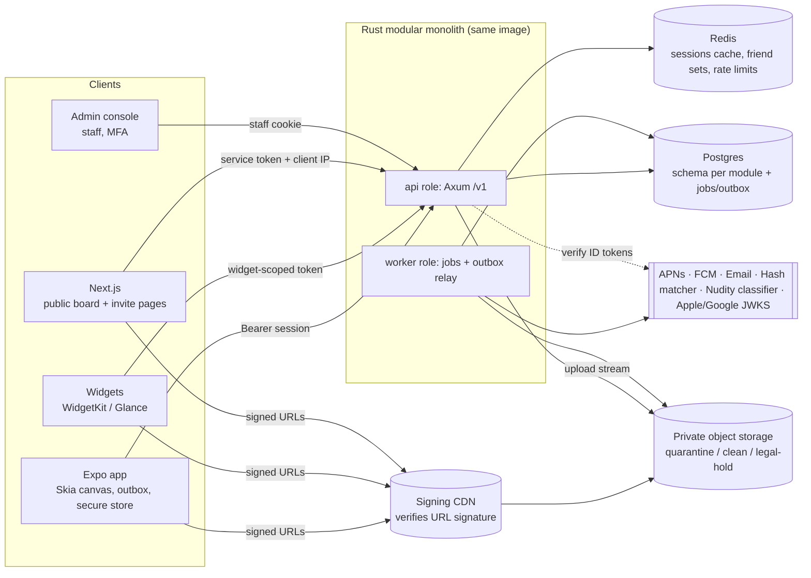
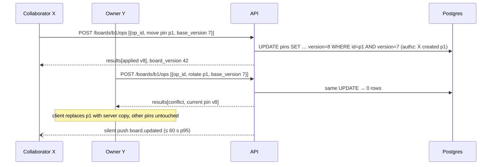
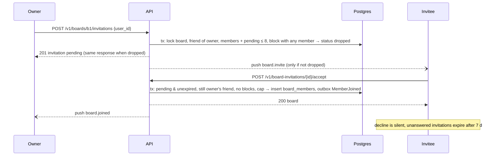
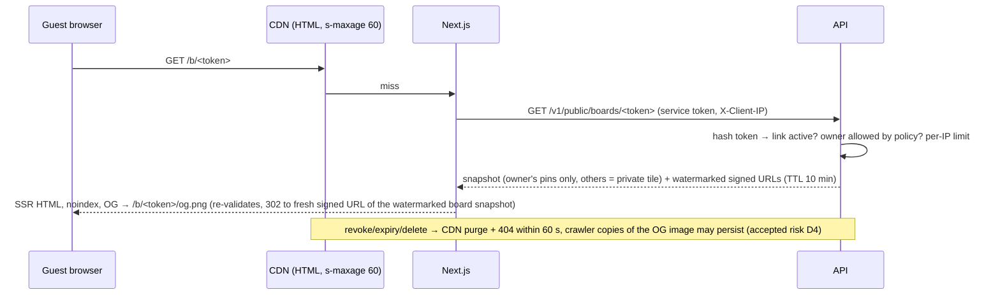
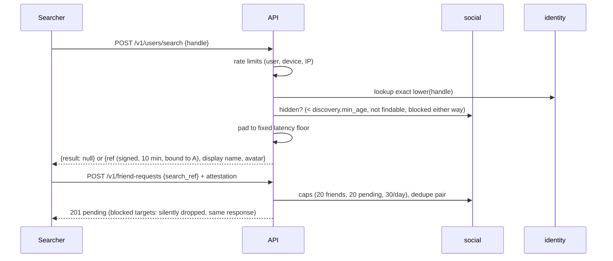

# Architecture Overview (MVP)
**TL;DR:** One Rust/Axum **modular monolith** (one image, two process roles: `api` and `worker`) over Postgres (one schema per
module), Redis (cache/rate limits only, never durable), private S3-compatible storage behind a signing CDN, and a Postgres-backed
job queue with a transactional outbox. Expo app is the primary client; Next.js renders only public board pages and invite landings
by calling server-to-server `/v1/public/*`. Everything authorization-related happens in the API ([[security-baseline]]).

## 1. Requirements & sizing (assumptions — revisit after beta)
| Item | Assumption / target | Source |
|---|---|---|
| Users | Beta 10k MAU; launch plan 100k MAU / 30k DAU | estimate |
| Sends | ~60k cards/day, fan-out ≤ 20 (avg ~8) → ~0.5M deliveries/day; peak ~10 sends/s | [[prd-mvp]] US-13 caps |
| API load | ~200 rps peak, p95 < 200 ms for reads, < 500 ms for writes (excl. upload) | estimate |
| Media | ~0.5 MB per card (render WebP/PNG ≤ 1080 px + 8-bit mask + derivatives) → ~30 GB/day, ~11 TB/yr | estimate |
| Delivery SLO | send → recipient widget p50 ≤ 10 s / p95 ≤ 60 s; unfriend/delete visible ≤ 60 s | AC-13.2, AC-6.1, AC-14.1 |
| Availability | API 99.5 %; CSAM hash + nudity classifier **fail-closed** (sends held, not delivered unchecked) | NFR, AC-28.2, AC-28.3 |

## 2. Components

| Component | Role | Notes |
|---|---|---|
| `api` process | HTTP `/v1`, authn/authz, validation, writes + outbox in one tx | Stateless, horizontal. utoipa OpenAPI → generated TS client |
| `worker` process | Job runner + outbox relay: media scan/derive, fan-out, push, snapshots, exports, deletion, purges | Same binary, `api worker`; scaled separately so CPU work never hurts API p95 ([[ADR-0006-job-queue]]) |
| Next.js (`apps/web`) | SSR `/b/<token>` and `/i/<token>`, OG images; no login, no editor | Calls only `/v1/public/*` with a service credential ([[ADR-0002-cross-platform-stack]]) |
| Admin console | Moderation queue | Separate origin, staff cookie session + MFA ([[ADR-0004-auth-sessions]]) |
| Postgres | System of record; one schema per module | PITR backups; see [[data-model]] |
| Redis | Session cache, friend/block sets, rate-limit buckets, push batching windows | Loss = degraded perf, never data loss |
| Object storage + CDN | Private buckets; CDN validates per-viewer signed URLs (TTL ≤ 10 min) | Provider = EM decision ([[ADR-0005-media-pipeline]]) |

## 3. Module / crate map
One crate per module under `crates/`; `apps/api` only wires routes and adapters. Modules talk **only** through public service
traits and domain events; each owns its Postgres schema and nobody else queries it ([[change-management]]).

| Crate | Owns (schema) | Responsibilities | May depend on |
|---|---|---|---|
| `platform` | `platform` | IDs, clock, errors, outbox, jobs, idempotency store, rate limiter, audit writer, `PersonalData` trait, text filter | — |
| `policy` | config only | `PolicyService::resolve(ctx)` region rules (exists) ([[region-policy]]) | — |
| `identity` | `identity` | Accounts, auth identities, sessions + rotating refresh tokens, magic links, age gate, `AgeService::is_minor`, profile, handle, devices/attestation, staff + MFA | platform, policy |
| `social` | `social` | Invites (minors: expiry + use cap), friend requests (+ "adult · no mutual friends" hint), friendships (cap 20), blocks, exact-handle search; `FriendGraph` trait | platform, policy, identity |
| `media` | `media` | Upload intake, quarantine → CSAM hash → nudity classifier → clean/held, derivatives, watermark, signed-URL issuance (signs, never decides access) | platform |
| `cards` | `cards` | Cards, recipients (inbox), reactions; `CardAccess` + `CardRender` traits | platform, social, media |
| `boards` | `boards` | Boards, invitations (accept required), members, pins, op log, version conflicts, per-viewer pin resolution incl. minor rule ([[ADR-0007-board-sync]]) | platform, identity, social, cards, media |
| `feed` | `feed` | Feed + widget queries (composes `cards` inbox × `FriendGraph`), activity tab | platform, cards, social, media |
| `sharing` | `sharing` | Public links, board snapshots, public view DTOs | platform, policy, identity, boards, cards, media |
| `notifications` | `notifications` | Push tokens, prefs, quiet hours, batching, caps, APNs/FCM, widget pushes | platform, identity (consumes others' events) |
| `moderation` | `moderation` | Reports, queue, actions, CSAM incidents, classifier holds + appeals | platform, identity, cards, boards, sharing, media |
| `privacy` | `privacy` | Data export ZIPs, account deletion orchestration via registered `PersonalData` impls | platform, identity |

Rules: dependency graph is acyclic (CI: `cargo depgraph` check + grep for foreign schema names in SQL). Notifications never
called directly — producers emit events (`CardDelivered`, `CardHeld`, `ReactionSet`, `FriendRequestCreated`, `BoardInvitationCreated`,
`MemberJoined`, `BoardChanged`, `NewLogin`).
Each module implements `PersonalData { export, hide, erase }` so `privacy` never touches foreign tables.

## 4. Key flows
### 4.1 Capture → send → widget update (US-7, US-13, US-16, US-28)
```mermaid
sequenceDiagram
  participant A as Sender app
  participant API
  participant PG as Postgres
  participant W as Worker
  participant H as Hash matcher
  participant P as APNs/FCM
  participant B as Recipient widget/app
  Note over A: capture + cutout + effects on-device (nothing uploaded yet)
  A->>API: POST /v1/media (render), POST /v1/media (mask) [Idempotency-Key]
  API->>API: size ≤ 10 MB, magic bytes; stream to quarantine
  API-->>A: media ids (state=uploaded)
  A->>API: POST /v1/cards {client_card_id, media ids, style, audience} + attestation
  API->>PG: tx: card(pending_scan) + recipients ∩ current friends + outbox CardSubmitted
  API-->>A: 202 card pending ("Sending…")
  W->>W: re-encode, strip EXIF, derivatives
  W->>H: CSAM hash match (retry w/ backoff if down → card stays held)
  H-->>W: no match
  W->>W: nudity classifier (down → retry, card stays held, flagged → card held_review, sender notified, appeal → moderation queue)
  W->>PG: tx: media clean, card active, recipients delivered_at, outbox CardDelivered
  W->>P: alert push (no image/caption/URL) + widget push / FCM data
  B->>API: GET /v1/widget (widget token)
  API-->>B: latest card + signed URL (TTL 10 min)
  B->>CDN: GET signed URL
```
On a hash match the worker blocks the card, suspends the account, copies evidence to legal hold and opens a `csam_incident` (US-28).
Before upload the app runs an advisory on-device nudity pre-check; the server classifier is authoritative (AC-28.3). The widget shows
the photo on the locked device too (AC-16.5, EM decision D3, accepted risk) from OS-protected cache, using its scoped read-only token;
unfriend/block/delete triggers a widget refresh push so it drops the card ≤ 60 s (AC-16.4).

### 4.2 Board pin edit with version conflict (US-19 AC-19.3)

Board reads are resolved per viewer: a card pin is shown only to its owner and current recipient-friends (AC-19.7); adults who are
not friends with a minor member see that member's pins as private tiles and display name only (AC-19.9) ([[ADR-0007-board-sync]]).

### 4.2a Board invitation (US-19 AC-19.1, AC-19.8)


### 4.3 Public link view on web (US-24)

### 4.4 Friend request via handle search (US-5a, US-5)


## 5. Cross-cutting
**Auth & sessions** — Apple/Google ID-token verification + PKCE-bound email magic link (Universal/App Links, in-app confirm, no
auto-linking) → opaque 10-min access token + rotating refresh token with reuse detection, session list, log out everywhere, new-device
alert; tokens in Keychain/Keystore, widget-scoped read-only token in the app group, staff HttpOnly cookie + MFA ([[ADR-0004-auth-sessions]]).
**Authorization** — route policy declared per handler (deny by default); object checks inside module services with scoped
queries; friendship/recipient/membership evaluated at **read time**; denial = 404 ([[prd-mvp]] permissions matrix).
**Region policy** — `PolicyContext` built per request from IP geo + stored store-country/declared country, strictest wins.
**Media** — API-streamed upload to quarantine, worker scan before any delivery, per-viewer CDN-signed URLs, per-link watermarked
derivatives for web ([[ADR-0005-media-pipeline]]).

### Caching
| What | Where | TTL / invalidation |
|---|---|---|
| Session by access-token hash | Redis | ≤ access TTL (10 min); deleted on logout/revoke/refresh reuse/suspend (Postgres fallback) |
| Minor flag per account | Redis | 24 h (`AgeService`); used by board resolution, invites, request hints |
| Friend set, block set per user (≤ 20 ids) | Redis | 10 min; deleted on `FriendshipChanged`/`BlockChanged` event in same request |
| Resolved policy | in-process | config hot-reload on deploy; version stamped in logs |
| Client config (limits, flags, registry kill switches) | CDN + app | 5 min |
| Public board HTML / snapshot / OG image | CDN / Redis | 60 s; explicit purge on revoke, expiry, board delete, snapshot rebuild (third-party crawler caches out of our control, D4) |
| Media bytes | CDN | immutable random keys, cache by path (signature excluded from cache key) |
| Feed (last 50), boards | app (TanStack Query + SQLite) | offline per AC-15.1 / AC-18.3 |

### Async jobs (Postgres queue + outbox, [[ADR-0006-job-queue]])
`media.process` (re-encode, EXIF strip, derivatives, hash match, nudity classifier) · `cards.deliver` (mark delivered, emit events) ·
`notify.push` (batch > 3 new cards/10 min, quiet hours, 30/day cap) · `widget.refresh` (also on unfriend/block/delete, ≤ 60 s) ·
`boards.expire_invitations` (7 d) · `moderation.expire_holds` (30 d) · `sharing.snapshot` (debounced on
`BoardChanged`) · `sharing.purge_cdn` · `privacy.export` (≤ 48 h) · `privacy.erase` (after 7-day grace, done ≤ 30 d) ·
`social.expire_requests` (14 d) · `platform.purge` (retention) · `moderation.csam_report`. All handlers idempotent by key.

### Realtime later (Phase 2) without breaking the model
Pins already have client-generated UUIDv7 ids, flat per-field state, fractional `z_key` and per-pin LWW — the same semantics as a
Yjs `Y.Map` per pin. Phase 2 adds a WebSocket gateway in the `api` role with a `yrs` doc per board; `board_ops` becomes the update
log and REST `/ops` becomes an adapter onto the doc ([[ADR-0007-board-sync]]).

## 6. Failure modes
| Failure | Blast radius | Behavior |
|---|---|---|
| Hash matcher or nudity classifier down / slow | New sends + avatars | Held in queue (fail closed), retries w/ backoff, page on-call at queue age > 5 min |
| Classifier false positive | One sender's card | Card `held_review`, sender notified, appeal → moderation queue; released cards deliver normally |
| Postgres down | Everything server-side | API 503 + `Retry-After`; app keeps working offline, outbox retries with same idempotency keys |
| Redis down | Latency, rate limiting | Sessions/friend sets read from Postgres; auth & search rate limits fail **closed**, others fall back to in-process limiter |
| Storage/CDN down | Uploads, images | Upload 503 → outbox retry; cached images on device; no delivery without stored media |
| APNs/FCM errors | Push only | Retry w/ backoff; prune invalid tokens; activity tab + pull-to-refresh remain source of truth |
| Worker backlog | Delivery latency SLO | Autoscale on queue age; priority lanes (scan/deliver > snapshot > export/purge) |
| Duplicate submits / job retries | Correctness | Idempotency-Key, `client_card_id` unique, `op_id` unique, job unique keys |
| Bad deploy | All | Expand/contract migrations, feature flags + kill switches, roll back image |
| Data loss | All | Managed PITR (7–14 d), monthly restore drill; erased-user list replayed after any restore |

## 7. Observability
- `tracing` JSON logs with `request_id`, `user_id` (opaque), route, outcome; **no** tokens, emails, DOB, captions, handles in logs.
- OpenTelemetry traces API → job → push (trace id carried in outbox/job rows). Errors to a tracker with PII scrubbing, no source maps public.
- Metrics/SLOs: RED per route; `send_to_delivered_seconds` histogram (p50 10 s / p95 60 s); scan latency + hold count; job queue
  depth/age per lane; push success/invalid-token rates; rate-limit rejections; public-link views per token (anomaly → auto-disable).
  Implemented (T-97, `apps/api/src/workers.rs` `SloReport`, worker task `metrics.slo_report` every 60 s): log-based metrics until
  a metrics backend exists. Each minute over a 15 min window: `metrics.send_to_delivered_seconds` {count, p50, p95}
  (`cards.delivered_at - sent_at`), `metrics.scan_seconds` (media `scanned_at - created_at`), `metrics.holds_open`,
  `metrics.queue` per lane {depth, oldest_age_secs, dead}, `metrics.push` {sent, failed, no_target, capped, batched,
  invalid_tokens}. Alerts are `ERROR` events for the log pipeline to page on: `alert.queue_age` (oldest due job > 300 s on any
  lane) and `alert.delivery_slo` (p95 > 60 s); the thresholds are pure functions with a synthetic test. Each module computes its
  own numbers (`CardService::delivery_latency`/`open_holds`, `MediaService::scan_latency`, `Notifier::outcomes_since`,
  `PushTokens::invalidated_since`, `JobQueue::stats`). The staging dashboard and alert routing wait for the staging deploy.
- Audit log (append-only) for auth events, staff actions, config changes, public link create/revoke.

## 8. Deployment & evolution
One container image (`api` / `worker` roles) + Next.js; managed Postgres (PITR) and Redis; S3-compatible storage + CDN; single
region at launch. 10×: read replica for feed/board reads, more workers, partition `cards.card_recipients` by month. 100×: split
`media` worker fleet, consider fan-out read model in Redis; still one API codebase unless a module proves a distinct scaling need.

## Open questions
- ~~Hosting~~ — decided in [[ADR-0008-hosting]] (Supabase Postgres, Cloudflare R2/CDN, Fly.io, Upstash). Still open: EU data residency stance ([[ADR-0005-media-pipeline]]).
- **EM (PRD Q9):** hash-matching provider (PhotoDNA vs Thorn Safer); blocks launch, not design.
- **EM (D6):** nudity classifier choice (self-hosted vs vendor) + threshold, and moderation staffing for appeals.
- iOS background/widget push budgets may miss p95 60 s for `board.updated`; fallback is refresh on open (to verify in spike).
- iOS deferred deep link for invites without fingerprinting (AC-4.2): Android Install Referrer; iOS = re-open link after install.
