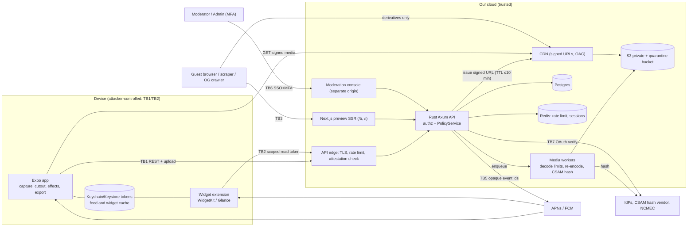

# Threat model — MVP
**TL;DR:** The app, the widget and the web page are attacker-controlled (Frida, mitmproxy, repackaged APK, replayed
requests, scrapers). Everything we protect is enforced by the Rust API at **read time** (recipient ∧ still-friend ∧
not-blocked ∧ not-deleted) and by **what we never send** (originals, other users' data, long-lived URLs). The top risks are
(1) **pin laundering**: a shared board exposing a friend's card to people it was never sent to, (2) **adults reaching minors**
through public invite links, being added to boards, or a self-declared DOB, (3) object-level authz bugs (IDOR/BOLA) on
cards/pins/boards/media, (4) **CSAM/NSFW** slipping past hash matching because cutout and effects change the image,
(5) **account takeover** through magic links or session theft. Copying content a user is entitled to see (screenshots,
modified client "export") **cannot be prevented**; we rely on traceability and deterrence (§8).
Method: [[security-baseline]] + security skill Mode A (STRIDE). Scope: [[prd-mvp]] Must/Should items, with Phase 2 ads/Pro designed in.

## 1. Assets (ranked)
| # | Asset | Why it matters | Where it lives |
|---|---|---|---|
| 1 | Private card images, masks, kept originals (often pets, sometimes faces, sometimes minors) | Core promise is "private, close friends"; a leak breaks trust and can harm minors | S3 private bucket, CDN edge cache, device caches (feed, widget, outbox) |
| 2 | Minor status and how minors can be found (DOB, age band, handle, invite links, board membership) | Strangers contacting minors is the worst safety outcome; regulators focus on it (COPPA, AADC, DSA Art. 28, OSA) | Postgres `users`, invite tokens, search index |
| 3 | Sessions and credentials (refresh tokens, magic-link tokens, OAuth `id_token`s) | Account takeover gives full access to assets #1 and #2 | Device Keychain/Keystore, Redis/Postgres |
| 4 | Social graph (friends, blocks, board collaborators, recipient lists) | Shows who knows whom; blocks must stay secret | Postgres |
| 5 | Capability tokens (public board links `/b/<t>`, invites `/i/<t>`, signed media URLs, export ZIP URLs) | Anyone holding one gets access | URLs, CDN logs, chat apps, Referer headers |
| 6 | Moderation data, reports, CSAM evidence | Legally regulated; insiders could leak it | Quarantine bucket, moderation DB |
| 7 | PII: email, IP, push tokens, device ids, DOB-refusal cooldown hash | Privacy law, account enumeration | Postgres, logs |
| 8 | Platform integrity: URL-signing keys, JWT keys, APNs/FCM credentials, region policy config, effect registry, OTA update channel (EAS) | One compromise affects every user (mass push, malicious OTA bundle, policy weakened) | Secret manager, CI, EAS |
| 9 | Entitlements (Phase 2: Pro, ad rewards, credits) | Revenue fraud | Server ledger ([[monetization]]) |
| 10 | Brand mark / watermark on exports | Growth loop and traceability | Rendered on the device (so the client controls it) |

## 2. Actors
| Actor | Capability | Goal |
|---|---|---|
| Curious or malicious friend | Valid account, legitimately receives cards; Frida/mitmproxy; modified app | Keep, export or re-share friends' cards; see reactions or boards they shouldn't |
| Ex-friend (unfriended or blocked) | Old cached URLs and feed, knows card/board ids | Keep viewing after removal; find out they were blocked |
| Malicious board collaborator | Friend of the owner on a shared board | Delete or move other people's pins, take over the board, see third-party cards |
| Stalker / predatory adult targeting minors | Many accounts, VPNs, can lie about DOB (even claim to be a minor), finds invite QR codes posted on TikTok | Find, befriend and contact minors; join their boards |
| Scraper bot | Headless browsers, residential proxies, token lists taken from social posts | Bulk-download public boards; enumerate handles and tokens |
| Spammer / sockpuppet farm | Device farms, emulators, rotating accounts | Friend-request spam, push spam, get around rate limits |
| Account thief | Phished email, SIM swap, stolen or rooted phone | Take over the account and export data |
| Abusive uploader | Normal client or crafted HTTP requests | Spread CSAM/NSFW; crash decoders with malicious files |
| Insider (moderator, support, engineer) | Console access, production access | Browse private content, leak evidence, ban people unfairly |
| Compromised device / malware | Root/jailbreak, other apps, a shared iPad, the lock screen | Read tokens, caches and widget content |
| Supply-chain attacker | Compromised npm/crate, EAS account or CI | Push a malicious OTA update or exfiltrate tokens |
| Fraudster (Phase 2) | Forged ad callbacks, patched `isPro` | Free Pro features and credits |

## 3. Trust boundaries & data flow
| ID | Boundary | Untrusted side → trusted side |
|---|---|---|
| TB1 | Mobile app ↔ API edge (REST/JSON, TLS) | Everything from the app: ids, recipients, DOB, region hints, attestation, timestamps |
| TB2 | Widget extension ↔ app container on the device | Shared App Group / Glance storage; shown on home screen, lock screen and StandBy |
| TB3 | Guest browser ↔ Next.js web / CDN | Public link token, scrapers, social crawlers fetching OG images |
| TB4 | API/workers ↔ S3 / CDN | Signed URLs leave our control once issued |
| TB5 | API ↔ APNs / FCM | Third-party push transport; device tokens supplied by the app |
| TB6 | Staff ↔ moderation console | Privileged humans; reported content and CSAM evidence |
| TB7 | API ↔ IdPs (Apple, Google, email sender), CSAM hash vendor, NCMEC | External identity and safety services |
| TB8 | CI / EAS ↔ app stores and OTA channel | Code and update supply chain |

## 4. STRIDE per boundary
| Boundary | Spoofing | Tampering | Repudiation | Information disclosure | DoS | Elevation of privilege |
|---|---|---|---|---|---|---|
| TB1 client↔API | Stolen or replayed tokens; forged magic link; repackaged app | Edited `recipients`, `owner_id`, `card_id`, pin transforms, DOB/region hints, idempotency keys | "I didn't delete that pin or send that card" | IDOR on cards/boards/reactions; extra fields in DTOs; enumeration through errors or timing | Upload floods, search hammering, outbox replay storms | Mass assignment (`role`, `is_owner`), collaborator acting as owner, user calling admin routes |
| TB4 API↔storage/CDN | Requests forged without a signature; direct bucket access | Path or parameter tampering on signed URLs; cache poisoning | No record of who received which URL | Shared or replayed signed URLs; CDN caching private objects past revocation; listable bucket | Expensive derivative requests; decompression bombs reaching workers | Wildcard signing policy (one signature unlocks a whole prefix) |
| TB5 API↔push | Attacker registers someone else's token or reuses it across accounts | Payloads changed in transit (provider-side) | No delivery log | Captions or images on the lock screen; media URLs in payloads | Push spam via fan-out; batching bypassed | Client picks push targets |
| TB3 web preview | Phishing clones of `/b` pages | XSS through display name or caption; OG text injection | Guest reports without attribution | Token scraping, OG image cached by crawlers after revoke, friends' cards, `index` leaks | Hammering one link; SSR cost | Guest reaching app APIs through Next.js server credentials (SSRF/proxy) |
| TB2 widget extension | Widget reusing the app's full-power refresh token | Shared container written by another process (compromised device) | — | Content shown on lock screen/StandBy/shared iPad; cache remains after logout, unfriend or delete | Push-driven refresh loops drain battery | Widget token used to call write endpoints |
| TB6 moderation console | Phished staff credentials | Moderators editing audit logs; tampered report queue | Unlogged actions or views | Browsing private data; CSAM evidence leaks | Report flooding to bury real reports | Moderator → admin; support triggering deletion without verification |

## 5. Abuse cases
L = likelihood (H/M/L, given free tools). I = impact (Crit/H/M/L). SR = requirement in §6. "NEW AC" = proposed PRD addition.

### 5.1 Access control & content theft
| ID | Abuse case (as an attacker I want to…) | L | I | Mitigation → requirement | Residual | Negative test |
|---|---|---|---|---|---|---|
| A-01 | **IDOR on cards/media**: swap `card_id` in `GET /cards/{id}` or `/cards/{id}/media` to view cards not sent to me | H | Crit | One query scoped as recipient ∧ friend ∧ not blocked ∧ not deleted; 404 on deny; UUIDv7 ids; authz-matrix tests (SR-3, SR-4, SR-5; Permissions matrix) | L | User C requests card A→B: 404, byte-identical to a missing id; same after A unfriends B |
| A-02 | **Pin laundering**: (a) create a pin with someone else's `card_id` so the board read hands me a signed URL; (b) owner pins friend X's card on a shared board so collaborators who were never X's recipients see it | H | H | AddPin checks the caller can view the card; board read re-checks visibility **per viewer**; NEW AC-19.7: third-party cards on shared boards show as a "private card" tile to collaborators outside the card's recipient list (same rule as AC-24.3) (SR-6) | L | Collaborator Y not in X's recipients: `GET /boards/{id}` returns a placeholder with no media URL; `POST pin{card_id: foreign}` → 404 |
| A-03 | **Keep viewing after unfriend/block/delete**: replay signed URLs, keep using the feed cache, patch the client to ignore purges | H | M | Read-time checks (matrix footer); TTL ≤10 min (SR-8); CDN never caches private objects past TTL; deleting a card deletes the storage object (AC-14.1); sync-time purge instruction to clients (best effort, SR-9) | M (files already downloaded stay on the device) | After unfriend: feed excludes the card; requesting a new URL → 404; old URL → 403 after TTL |
| A-04 | **Share or replay signed URLs** taken from mitmproxy, or tamper with the path | H | M | Signature covers exact object key + expiry; random object keys; Origin Access Control (no public bucket); per-user URL-issuance budget + anomaly alerts (SR-8, SR-10) | M within TTL | Expired URL → 403; changed key or size → 403; direct S3 GET → 403; listing denied |
| A-05 | **Bulk scraping by a friend**: a Frida script pages through feed and boards to download everything, including originals | M | M | Per-user media fetch rate caps; **originals ("keep original") served to the owner only** (NEW AC-13.6); recipients get display derivatives (SR-11) | M (a friend can still save what they're allowed to see) | Recipient asks for `variant=original` → 404; 1,000 media requests/min → 429 + alert |
| A-06 | **Widget leaks content** on lock screen, StandBy or a shared iPad; stale content after unfriend or logout | M | M | Widget gets a scoped, read-only token; cache uses Data Protection (complete-until-first-unlock) / app-private storage; shown on the lock screen per EM decision D3 (Locket parity — accepted risk; protected cache + scoped token remain); NEW AC-16.4: widget re-validates within 60 s of unfriend, block or delete; AC-16.2 (SR-14) | L | Unfriend → widget empty within 60 s; locked device shows the photo by design (D3); logout → widget cache cleared; widget token on `POST /cards` → 403 |
| A-07 | **Push token hijack / payload leak**: register my token on another account or someone else's token on mine; read captions on the lock screen | M | M | Device token unique across accounts (re-registering moves it), bound to session, removed on logout/delete; payload = opaque event id + generic text; app fetches details with auth (AC-31.2, SR-15) | L | Token T moved from A to B → A stops getting pushes; logout → nothing delivered; payload contains no URL/caption field |
| A-08 | **Public link enumeration/scraping**: guess tokens, scrape known links, keep the OG image after revoke | H | M | 128-bit tokens; uniform 404s; per-IP and per-token budgets; `noindex`; HTML cache TTL < signed-URL TTL; server-watermarked derivatives ≤1080 px; OG image is a watermarked board snapshot of the owner's cards, purged on revoke; crawler copies may persist (EM decision D4, accepted); anomaly auto-disable (AC-24.1–24.5, SR-16, SR-17) | M (crawler caches of OG images) | 10k random tokens → all 404, similar latency, IP throttled; revoked → 404 and OG URL dead within 60 s |
| A-09 | **Board collaborator escalation**: PATCH `owner_id`/`role`, move or delete others' pins, add collaborators, create a public link, replay edits after being removed | H | H | Policy per action; `pin.created_by` taken from the session; allow-listed DTOs; version check; removed members' queued writes rejected (AC-19.2, AC-19.6, SR-3, SR-7) | L | Collaborator DELETE on another member's pin → 404; PATCH `{owner_id}` ignored/400; POST public link → 404 |
| A-10 | **Export friends' cards / strip the watermark** with a patched app (export and the brand mark are on-device) | H | M | Cannot be enforced (the client already has the decoded image). AC-23.2 only governs the honest app. Watermark on server-rendered derivatives (public page) is enforced. Option: per-recipient invisible forensic mark (EM decision D2) (SR-18) | H (accepted) | API has no endpoint returning another user's original; public derivatives carry the server watermark |

### 5.2 Discovery, minors & social abuse
| ID | Abuse case | L | I | Mitigation → requirement | Residual | Negative test |
|---|---|---|---|---|---|---|
| A-11 | **Handle-search enumeration / finding minors through timing**: compare latency, body size, headers, friend-request errors, or the handle-availability check | H | H | Same code path and DB work for every outcome, padded to a fixed latency bucket, byte-identical "No one found"; request errors identical too; claim-availability check rate-limited (it necessarily reveals "taken"); per user + attested device + IP limits; low quotas for new accounts; alert on miss rate (AC-5a.1–5a.3, SR-19) | L–M ("taken" means hidden or existing, not specifically a minor) | 1,000 searches minor vs missing handle: KS test p > 0.05 and identical bytes; friend request to a hidden user returns the same generic response |
| A-12 | **Invite token brute force / public invites**: a minor posts a QR code, adult strangers send requests | M | H | 128-bit tokens; per-IP limit on token resolution; NEW AC-4.4: for minors, invites expire (default 7 d) and/or have a use cap (config); invite web page shows display name only (no avatar card) for minors; the minor sees an "adult, no mutual friends" hint on the request (SR-20) | M | 10k random tokens → generic 404 + throttle; minor's invite after 7 d → "expired" |
| A-13 | **Adult contacts a minor through a shared board** (collaborators need not be friends with each other); **forced membership** (AC-19.1 adds people without asking) | M | H | NEW AC-19.8: joining a board needs the invitee's acceptance; blocked users can't be co-collaborators; NEW AC-19.9: adult collaborators who aren't friends with a minor collaborator see the minor's cards as "private card" tiles and see display name only (EM decision D5) (SR-21) | M | Owner adds Y → Y gets an invitation, not membership; adult non-friend gets a tile for the minor's pin |
| A-14 | **Mass friend-request spam / sockpuppets** | H | M | Acceptance required; 20 pending + 30/day; 14 d expiry; block stops re-requests; attestation at sign-up and accept (AC-5.1–5.4, SR-22) | L | 31st request in a day → 429; blocked user re-requests → same generic response, nothing delivered |
| A-15 | **Rate-limit bypass by rotating devices/IPs/accounts** | M | M | Limits keyed primarily on **account**, plus attested key id (App Attest / Play Integrity) and IP/ASN; sign-up gated by attestation + IP reputation; reduced quotas for new accounts for 7 d; global circuit breakers (SR-22, SR-23) | M (attestation farms exist) | Same account across 5 devices shares one quota; unattested sign-up → challenge or reject |
| A-16 | **Region spoofing past the age gate** (VPN + fake storefront/declared region) | M | H | Strictest-of-signals (AC-2.1); storefront value from the client is a hint only; IP observed on the server; resolved region **stored at sign-up**; minor-protection features use the strictest of stored and current (SR-24) | M | Declared US + EU IP + DOB 15 → refused; later login from a lax region doesn't lower `discovery.min_age` |
| A-17 | **DOB lying**: a minor claims adulthood (becomes searchable, gets public links); **an adult claims to be a minor** to reach minors | H | H | Self-declared DOB (Q5); DOB locked (AC-2.3); 24 h device+account cooldown; add OS age signals (Apple Declared Age Range, Google Play Age Signals) as an extra strictest signal where law requires or allows (legal L-3); "minor safety" reports prioritized (SR-25) | H (accepted for MVP) | DOB retry from the same device within 24 h → refused; signal says under 18 but DOB says adult → treated as a minor |
| A-18 | **Report abuse**: mass false reports to get someone suspended | M | M | No automatic action except on CSAM hash hits; dedupe per target; reporter must have access to the content; reporter reputation weighting (SR-31) | L | 50 reports from new accounts → queue item only, no suspension |

### 5.3 Content, files, accounts, platform
| ID | Abuse case | L | I | Mitigation → requirement | Residual | Negative test |
|---|---|---|---|---|---|---|
| A-19 | **CSAM / NSFW upload**; cutout, borders and effects defeat perceptual hashes; "keep original" is off by default, so the source is never seen | M | Crit | Hash every uploaded image (render, mask, original) **before any URL is issued**, fail closed (AC-28.1/28.2); NEW AC-28.3: nudity classifier on every send (on-device pre-check + server check, flagged ⇒ held for review, appeal ⇒ queue; EM decision D1); priority queue (SR-26) | M (new content isn't in hash lists) | Vendor test image → blocked, no URL, account suspended; hash service down → card stays queued |
| A-20 | **Malicious image files**: decompression bomb, PNG/HTML or PNG/ZIP polyglot, decoder CVE, GPS in EXIF, ICC exploit | M | H | ≤10 MB; read dimensions from the header before decoding (≤4096² px, pixel budget); decode in an isolated worker (memory-safe Rust decoder with limits, timeout, memory cap, seccomp); re-encode from pixels only, all metadata stripped; served from a cookieless media domain with fixed `Content-Type`, `nosniff`, `Content-Disposition` (SR-27) | L | 50k×50k header → 400 in under 50 ms; polyglot output is pure PNG; EXIF GPS absent; mask whose size differs from the render → 400 |
| A-21 | **Hostile board/pin/caption data crashes other users' devices or the web page**: NaN or huge scale, 10k pins, zalgo/bidi caption, unknown registry ids, XSS in display name | M | M | DTO ranges (finite, clamped transforms, z-order bounds), registry-id allow-list on the server, NFC normalization, strip bidi controls, limit combining marks, JSON size caps; React escaping + nonce CSP on web; OG text rendered safely (SR-28) | L | `scale: 1e308` → 400; `<script>` display name renders inert on `/b` and `/i`; unknown `fx.*` → 400 |
| A-22 | **Account takeover via magic link**: forwarded link, email scanner pre-click, token leaked in logs/Referer, long TTL, auto-linking accounts by email | M | Crit | 256-bit token, stored hashed, single use, 15 min TTL; **bound to the requesting device** (PKCE-style verifier); opened only via Universal/App Links; confirmed in the app (GET doesn't consume it); generic replies (AC-1.2); no auto-linking of Apple/Google/email accounts by email address; new-login alert on other devices (SR-1, SR-2) | M (compromised email inbox) | Link reused → fail; opened on device B → fail; after 15 min → fail; scanner GET doesn't log in |
| A-23 | **Session theft from a compromised or rooted device** | M | H | Tokens in Keychain/Keystore only; access token 10 min; rotating refresh token with reuse detection; session list + "log out everywhere"; re-auth for delete/export (AC-29.1, AC-30.1) (SR-2) | M (malware on a rooted phone) | Replayed old refresh token → whole token family revoked |
| A-24 | **Effect registry / asset / OTA tampering**: patched registry, malicious Lottie, hijacked EAS update | M (OTA: L) | H (OTA: Crit) | Effects only change the user's own card, which is still hashed and moderated; MVP parses only bundled Skottie/Lottie; remote config is unlock flags only, never code; expo-updates **code signing**, MFA on EAS/stores, protected release channel; Phase 2 packs pinned by hash in the registry (SR-29, SR-30) | L | OTA with a bad signature → rejected by the app; card metadata with unknown effect id/version → 400 |
| A-25 | **Pro / ad-reward forgery (Phase 2)**: patched `isPro`, forged reward callback, replayed transaction ids | H | M | Entitlements only from RevenueCat/Stripe webhooks and AdMob SSV/AppLovin callbacks (signatures verified), single-use nonce, txn id idempotency, attestation, daily caps; no entitlement field in client-writable DTOs; on-device-only Pro effects are inherently bypassable → put Pro value in server-enforced features ([[monetization]], SR-34) | M (on-device unlocks) | Forged SSV signature → 400; same txn twice → credited once |
| A-26 | **Insider / moderator abuse**: browse private content, leak evidence, ban unfairly | L | H | Moderators see reported items only, through short-lived URLs, blurred by default (AC-27.2); append-only audit log of views and actions (stored off-box); SSO + MFA + IP allow-list; least-privilege roles; CSAM quarantine with its own key and role; break-glass production DB access with audit (SR-32, SR-33) | L–M | Moderator GET on an unreported card → 404; each view writes an audit row; moderator calling an admin route → 403 |

## 6. Security requirements (MVP backlog)
| SR | Requirement | Maps to |
|---|---|---|
| SR-1 | Magic link: 256-bit, hashed at rest, single use, 15 min TTL, device-bound verifier, Universal/App Links only, in-app confirm; OAuth: verify `iss/aud/exp/nonce`; no auto-linking accounts by email | AC-1.1/1.2 + NEW AC-1.3 |
| SR-2 | Sessions: 10 min access token + rotating refresh token with reuse detection; Keychain/Keystore; session list + log out everywhere; re-auth for delete/export/email change; new-login notice | NEW AC-1.4 |
| SR-3 | Deny-by-default policy on every route (function + object level); CI fails on a route with no policy; allow-listed request DTOs, per-audience response DTOs | Permissions matrix, baseline §3 |
| SR-4 | Visibility = recipient ∧ friend ∧ ¬blocked ∧ ¬deleted, evaluated in one scoped SQL query at read time; 404 on deny | Matrix footer, AC-6.1, AC-14.1 |
| SR-5 | Authorization-matrix integration tests generated from the permissions matrix (every role × action, including guest) | baseline §6 |
| SR-6 | AddPin verifies card visibility; board reads filter pins per viewer; third-party cards on shared boards show as a tile to non-recipients | NEW AC-19.7 |
| SR-7 | Board mutations: `created_by`/owner from the session; per-pin version check; removed members' writes rejected; append-only board audit (who moved/removed which pin) | AC-19.2/19.3/19.6 |
| SR-8 | Media only through signed URLs bound to exact key + expiry, TTL ≤10 min (app) / ≤10 min (web); random object keys; OAC, bucket not public or listable | AC-24.5, matrix footer |
| SR-9 | Unfriend/block/delete purge cached items: clients send their cached card ids to `POST /v1/feed/purges` on every sync (≤ 30 s while open) and drop what it lists (best effort, T-83) | AC-6.1, AC-14.1 |
| SR-10 | Per-user signed-URL issuance and media-fetch budgets; anomaly alerts (rate, many IPs) | NEW (abuse) |
| SR-11 | Originals (if kept) are owner-only; recipients get display derivatives; EXIF stripped | NEW AC-13.6, AC-13.4 |
| SR-12 | Recipients intersected server-side with current friends at send time; idempotency keys scoped per user; responses carrying a one-time bearer secret (public link URLs) are stored for replay redacted, never with the secret (#333) | AC-13.1, NFR reliability |
| SR-13 | Attestation (App Attest / Play Integrity) on sign-up, send, invite accept, friend request, search; server-side verdict check | NFR security (extend to sign-up/search) |
| SR-14 | Widget: scoped read-only token, protected cache, lock-screen display per D3 (accepted risk), cleared on logout/delete, re-validated within 60 s on unfriend/block/delete | AC-16.2 + NEW AC-16.4/16.5 |
| SR-15 | Push: tokens unique per account and session-bound, pruned on logout/delete/invalid; payload = opaque id + generic text, no URL/caption/image; APNs/FCM credentials in secret manager | AC-31.2 (strengthen) |
| SR-16 | Public link: 128-bit token, revoke/expiry, per-IP and per-token rate limits, anomaly auto-disable, `noindex`, `X-Robots-Tag`, HTML cache TTL < URL TTL, purge ≤60 s incl. OG image | AC-24.1–24.5 |
| SR-17 | Web: strict CSP with nonces, `frame-ancestors 'none'`, HSTS, nosniff, Referrer-Policy `no-referrer` on `/b` and `/i` (tokens in the path); Next.js server holds no user credentials; source maps private | baseline §5 |
| SR-18 | Server watermark on public derivatives; on-device brand mark on exports (deterrence only); optional per-recipient forensic mark (D2) | AC-23.1, AC-24.5 |
| SR-19 | Handle search: one constant code path, fixed latency bucket, byte-identical miss; same for request-send errors; claim-check rate limit; new-account quotas; miss-rate alert | AC-5a.1–5a.3 |
| SR-20 | Invites: 128-bit, per-IP resolve limit, reset; for minors expiry + use cap, name-only preview, "adult, no mutual friends" hint | AC-4.1–4.3 + NEW AC-4.4/5.5 |
| SR-21 | Board invitations need acceptance; blocks respected across co-membership; minor-protection visibility on shared boards (D5) | NEW AC-19.8/19.9 |
| SR-22 | Friend-request caps per account (primary key); block prevents re-requests silently | AC-5.2–5.4, AC-26.2 |
| SR-23 | Rate limits keyed account → attested device → IP/ASN; 7-day reduced quotas for new accounts; global circuit breakers | AC-5a.3, AC-13.5 |
| SR-24 | PolicyService: strictest signal wins; resolved region stored at sign-up; minor features use strictest(stored, current); client region hints never loosen policy | AC-2.1, [[region-policy]] |
| SR-25 | Age: DOB locked, 24 h hashed cooldown; ingest OS age-range signals where available (legal L-3); age computed from DOB daily (no stale flags) | AC-2.1–2.4 |
| SR-26 | CSAM hash on every uploaded file before any URL is issued, fail closed; quarantine + legal preservation; nudity classifier per D1 | AC-28.1/28.2 + NEW AC-28.3 |
| SR-27 | Upload pipeline: size/dimension/pixel limits before decode, sandboxed decoder with time and memory caps, re-encode, metadata strip, cookieless media domain, fixed content type | NFR security |
| SR-28 | Strict validation of pin transforms, captions (NFC, bidi strip, combining-mark cap), display names, registry ids, JSON size | AC-12, AC-3.2, AC-18 |
| SR-29 | Supply chain: expo-updates code signing, MFA on EAS/App Store/Play/GitHub, protected branches, `cargo deny`/`cargo audit`/`pnpm audit`, lockfiles, SBOM | NEW (release) |
| SR-30 | Secrets (URL-signing, JWT, APNs, FCM, hash vendor) in the secret manager, rotated, never in the app bundle or `EXPO_PUBLIC_*` | CLAUDE.md rule 3 |
| SR-31 | Reports: dedupe, no automatic action except CSAM hash hits, captcha + rate limit for guests, reporter reputation. Guest captchas are verified by the API (port; fake adapter refused in production), guest IPs stored only as a keyed hash (T-142) | AC-26.1–26.3 |
| SR-32 | Moderation console on a separate origin; SSO + MFA + IP allow-list; reported-only access; blurred by default; least-privilege roles; 2-person rule for bans of accounts over 30 days old (D6) | AC-27.1/27.2 |
| SR-33 | Append-only, off-box audit log: auth events, moderator views and actions, admin config changes, break-glass production access | AC-27.1, baseline §2 |
| SR-34 | (Phase 2, design now) server-only entitlement and credit ledger; signed webhooks/SSV; nonce + txn idempotency; no entitlement field in client DTOs | baseline §7, [[monetization]] |
| SR-35 | Logs contain no tokens, signed URLs, emails or DOBs; request id + user id only; 4xx/5xx generic | baseline §5 |
| SR-36 | Data export ZIP: re-auth, 48 h delay with notice to all devices + email (can cancel), single-use 24 h URL | AC-30.1/30.2 |
| SR-37 | Deep links: verified Universal Links / App Links only; no custom URL scheme carrying tokens | AC-4.2, AC-24 |
| SR-38 | Development-only sign-in (`/v1/dev/*`, #306): `API_DEV_SIGN_IN` is refused at startup unless `API_ENV` is development or test (and re-checked when the router is built); off, the routes answer the same 404 as an unknown path before any policy check; it reaches only the fixed seed personas (`seed.<key>` subjects), never a real account; audited as `auth.sign_in` provider `dev` | #306 |

## 7. PRD gaps found (proposed ACs for [[prd-mvp]])
| Gap | Proposed AC |
|---|---|
| A received card pinned on a shared board is visible to collaborators who weren't its recipients (matrix: collaborator "✅ if pinned") | **AC-19.7** third-party cards show as a tile to non-recipients (A-02) |
| Adding a collaborator needs no acceptance; harassment and minor exposure | **AC-19.8** acceptance required; **AC-19.9** minor-protection visibility (A-13) |
| Who may fetch "keep original" files isn't specified | **AC-13.6** owner-only (A-05) |
| Widget on lock screen/StandBy; widget not refreshed after unfriend/delete | **AC-16.4** revalidate ≤60 s; **AC-16.5** shown on the locked device by EM decision D3 (accepted risk) with protected cache + scoped token (A-06) |
| Minors' invite links have no expiry; preview shows the avatar card | **AC-4.4** expiry/use cap; **AC-5.5** "adult, no mutual friends" hint (A-12) |
| No session, magic-link or account-linking rules | **AC-1.3/1.4** (SR-1, SR-2) |
| Only CSAM hashing; no nudity check on a 13+ platform | **AC-28.3** classifier (D1) |
| Public link OG image: crawlers can't fetch signed URLs and cache it after revoke | Decision D4 |
| Attestation listed only for send and invite accept | Extend to sign-up, friend request, search (SR-13) |
| Export restriction (AC-23.2) and brand mark (Q6) are client-side only | ToS + honest-limits note (§8) |

## 8. Honest limits & what we do instead
| Cannot prevent | Why | Deterrence / traceability we use |
|---|---|---|
| Screenshots and screen recording of received cards | The OS shows pixels; iOS has no screenshot block; Android `FLAG_SECURE` is bypassed on rooted devices or with another camera | Optional `FLAG_SECURE` on full-screen card view (friction only); ToS; report + block; per-recipient forensic mark (D2) ties a leak to an account |
| A modified/rooted client saving every image it receives, skipping the watermark, exporting friends' cards | The client must decode the image to show it | Server sends only display derivatives (no originals to recipients); fetch-rate caps + anomaly detection; attestation makes mass automation costly; revocation within TTL |
| Copies made before an unfriend or delete | Already on the device | Read-time checks, short TTL, purge events stop **future** access |
| DOB lying (both directions) | Self-declared by EM decision Q5 | Strictest signals, OS age-range APIs, reports, moderator suspension, design for minors by default (no search, no public links, board protections) |
| Device attestation farms / emulators passing checks | Attestation can be bypassed at a cost | Limits keyed on account, new-account quotas, behaviour signals |
| Certificate pinning bypass (Frida) | Pinning is client-side | Not relied on; all authz on the server. Pinning optional for anti-MITM on hostile networks only |
| New CSAM not in hash lists | Hashes match known material only | Classifier (D1), reports, priority SLA, mandatory reporting |
Rule (baseline §1): DevTools/root detection, obfuscation and right-click blocking are **friction, never controls**.

## 9. Items needing legal review
| # | Item |
|---|---|
| L-1 | Per-region `min_age`, `discovery.min_age`, `public_links.min_age` values (COPPA, GDPR Art. 8, UK AADC, KR PIPA) — [[region-policy]] |
| L-2 | Australia's social media minimum age (under 16) and the UK Online Safety Act children's risk assessment: does this app fall in scope? |
| L-3 | US state app-store age laws (e.g. Utah, Texas) and use of Apple Declared Age Range / Google Play Age Signals; consent and retention of those signals |
| L-4 | CSAM process: NCMEC reporting (18 U.S.C. §2258A, retention as extended by the REPORT Act), status of EU interim CSAM derogation, evidence quarantine access, vendor DPA (PhotoDNA vs Safer) |
| L-5 | EU DSA: notice-and-action, statement of reasons for moderation (Art. 17), minor protection (Art. 28), transparency reporting |
| L-6 | Forensic watermark embedding a user id = personal data processing; disclosure in the privacy policy |
| L-7 | Face/animal landmarks for effects: confirm on-device-only processing and stored anchor points aren't biometric identifiers (BIPA/GDPR Art. 9) |
| L-8 | DOB-refusal cooldown hash (data from a refused minor) — lawful basis and 24 h retention |
| L-9 | ToS: screenshot/re-share policy, acceptable use, account deletion grace period, backup purge within 30 days |

## 10. Decisions (EM 2026-11-04) — source: raw/discussions/2026-11-04-security-qa.md
| # | Decision | Notes |
|---|---|---|
| D1 | Nudity classifier on **every** send (AC-28.3) | on-device pre-check + server check |
| D2 | Per-recipient forensic watermark **post-beta**; MVP logs which derivative went to whom | |
| D3 | Widget **shows photos on the locked device** (AC-16.5) | **Accepted risk** (EM chose against the redact-by-default recommendation): shoulder-surfing / StandBy exposure. Kept: protected cache, scoped token, 60 s revalidation (AC-16.4) |
| D4 | OG image = **watermarked board snapshot** of owner's cards (AC-24.7) | **Accepted risk**: social crawlers may retain the preview after revoke; minors can't create public links |
| D5 | Shared boards: acceptance required, private tiles for non-recipients and minor protection (AC-19.7–19.9) | |
| D6 | Moderation staffing & hash vendor | still open (PRD Q9) |
| D7 | Residual risks accepted: screenshots, modified-client export, DOB lying | deterrence: report/ban, attestation, forensic watermark later |

## Open questions
- A-11 implemented (T-43): constant query path + latency bucket padding + byte-identical misses + caller-bound sealed refs;
  timing test in CI (KS p > 0.05). The handle-claim check (`/v1/me/handle/check`) still necessarily reveals "taken" (rate-limited).
- Once [[api-mvp]] and [[data-model]] land: map every endpoint to SR-3/SR-4 policies and check that visibility is one SQL predicate.
- Signed cookies vs per-object signed URLs on the CDN (cost/latency at 20-recipient fan-out) — `/system-design`.
- Managed auth vs in-house (baseline open question) affects SR-1/SR-2 implementation.
