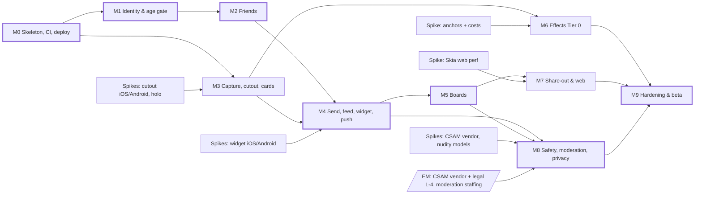

# MVP delivery plan
**TL;DR:** Ten milestones (M0 to M9) and 169 tickets (24 chore, 32 security, 104 feature, 9 spike). Every Must story in [[prd-mvp]] and every SR in
[[threat-model-mvp]] maps to at least one ticket (tables in section 9). Plan: sprint 0 (the walking skeleton, being built now) plus
**8 two-week sprints, about 18 weeks to a closed beta**, with 2 weeks of buffer. Backend is the busiest lane. The sequence
**identity → friend graph → media scan gate → send/read → board resolution → moderation/deletion → release** is the
dependency critical path. The **CSAM vendor contract** and the **nudity classifier choice** are the main outside blockers. They are
EM decisions, so both spikes run in sprint 1. Machine-readable backlog: `context/wiki/progress/backlog.json`. The first sprint is in [[sprint-1]].

## 1. Assumptions
| Topic | Assumption |
|---|---|
| Team | 4.5 parallel lanes (engineers or agents): Backend A (identity, social, boards, sharing), Backend B (platform, media, notifications, moderation, privacy), Mobile (screens, state, outbox, sync), Native/graphics (Expo modules, Skia shaders, widgets), Web/infra (half time: Next.js, admin console, CI/CD). With fewer people, the timeline grows roughly in proportion. Scope does not change. |
| Sizing | Sizes follow the sprint-planning skill: S ≤ ½ day, M ≤ 1 day (ideal, agent-assisted); L is always split. Spikes have a time box instead of a size (`timebox:Nd`). Total ≈ 157 ideal days. With a ~0.6 focus factor (review, integration, device testing) that comes to about 8 sprints. |
| Sprint 0 | The walking skeleton is sprint-0 output: monorepo, CI, local stack, staging deploy, Supabase lockdown, R2/CDN, EAS (T-1 to T-10 (10 tickets)). Sprint 1 assumes it has landed. |
| Process | Contract-first: each backend ticket updates the utoipa OpenAPI first. Mobile works against the generated client with MSW mocks, so lanes do not wait on each other. Every endpoint ticket adds rows to the authorization-matrix harness (T-12) and includes negative tests ([[testing-strategy]], [[security-baseline]]). |
| Done | Definition of Done in [[conventions]]. Changes follow [[change-management]]. Attestation is log-only in beta and hard-fail at GA ([[api-mvp]]). |

## 2. Milestones
| Milestone | Tickets | Rough duration | Sprints |
|---|---|---|---|
| M0 Walking skeleton, CI, deploy | T-1 to T-10 (10 tickets) | 2 wks | S0 |
| M1 Identity & age gate | T-11 to T-36 (26 tickets) | 4 wks | S1–S2 |
| M2 Friends | T-37 to T-49 (13 tickets) | 2 wks | S3 |
| M3 Capture, cutout & cards | T-50 to T-69 (20 tickets) | 6 wks (native lane, parallel) | S1 spikes, S2–S4 |
| M4 Send, feed, widget & notifications | T-70 to T-97 (28 tickets) | 4 wks | S4–S5 |
| M5 Boards | T-98 to T-112 (15 tickets) | 2–3 wks | S6 (+ spill to S7) |
| M6 Effects (Tier 0) | T-113 to T-125 (13 tickets) | 4 wks (native lane, parallel) | S4–S6 |
| M7 Share-out & web preview | T-126 to T-135 (10 tickets) | 3 wks | S1 spike, S6–S7 |
| M8 Safety, moderation & privacy | T-136 to T-156 (21 tickets) | 4 wks (+ vendor lead time running from S1) | S1 spikes, S6–S7 |
| M9 Hardening & beta | T-157 to T-169 (13 tickets) | 2 wks + 2 wks buffer | S8 (+ buffer) |

### M0 — Walking skeleton, CI, deploy
- **Goal:** a deployable, observable, locked-down skeleton that every lane builds on.
- **Exit:** merging to main deploys api + worker + web to staging. CI runs fmt, clippy, tests, cargo-deny/audit, pnpm lint/typecheck, OpenAPI drift, gitleaks, English-only and wiki lint. Supabase anon/authenticated roles have no grants. R2 buckets are private, with edge-verified signed URLs. A staging app build comes from EAS with signed OTA updates.
- **Risks:** Supabase pooler mode vs SQLx/LISTEN-NOTIFY ([[ADR-0008-hosting]]). Universal Link domain needed early for magic links.

### M1 — Identity & age gate (US-1, US-2, US-3)
- **Goal:** a real user signs in (Apple, Google, magic link), passes the region age gate, and sets a name and handle. Every route is deny-by-default.
- **Exit:** AC-1.1–1.4, AC-2.1–2.4, AC-3.1–3.3 pass on staging. The route-policy CI gate (T-11) and authz harness (T-12) are live. Job queue, outbox and idempotency store are ready for M2+. Attestation is verified server-side in log-only mode.
- **Risks:** we own auth correctness (nonce, JWKS rotation, refresh races, [[ADR-0004-auth-sessions]]). Universal/App Links setup. OS age-signal APIs and their legal basis (L-3), shipped behind a flag.

### M2 — Friends (US-4, US-5, US-5a, US-6, part of US-26)
- **Goal:** close friends connect through invite link/QR or exact-handle search, with minors protected.
- **Exit:** invite → request → accept, with caps (20 friends, 20 pending, 30/day) and 14-day expiry. Minor invite rules and the "adult · no mutual friends" hint work. The handle-search timing test passes (KS p > 0.05, identical bytes). Unfriend and block are silent. The `/i/<token>` web landing page has strict headers.
- **Risks:** enumeration side channels in search (T-43). iOS deferred deep link has no fingerprint-free option (T-49).

### M3 — Capture, cutout & cards (US-7, US-8, US-10, US-11, US-9, US-12)
- **Goal:** on-device capture → cutout → refine → cut style → finish → squish → a baked card, with nothing uploaded.
- **Exit:** AC-7.1–7.6 and AC-8.1 met on reference devices. ≥ 6 cut styles from the registry (AC-10.1/10.2). Matte/glossy/holo plus squish/haptics/sound with reduced-motion variants (AC-11.1–11.3). The network-log test proves no upload before send. The server validates style registry ids.
- **Risks:** segmentation latency on low-end Android and the fallback model licence without Play services (AC-7.6). Holo/squish frame budget. App size ≤ 60 MB.

### M4 — Send, feed, widget & notifications (US-13–US-17, US-28 gate, US-31)
- **Goal:** the core loop. A card goes through the fail-closed scan gate, reaches friends' feeds and widgets, and gets reactions.
- **Exit:** send → recipient widget p50 ≤ 10 s / p95 ≤ 60 s on staging. Unfriend/block/delete is visible within 60 s. CSAM hash gate and nudity classifier gate are fail-closed (a fake vendor adapter is acceptable here). Visibility is one SQL predicate with matrix tests. The offline outbox causes no duplicates. Push payloads carry no content. Both widgets work, including the lock screen (D3).
- **Risks:** iOS widget push budget may miss p95 60 s (T-89). Image decoder attack surface. M4 is the busiest milestone (28 tickets) and is split across both backend lanes.

### M5 — Boards (US-18, US-19, US-20)
- **Goal:** personal and async shared boards with per-viewer pin resolution, so pins cannot launder cards to people who were never sent them.
- **Exit:** AC-18.1–18.4 and AC-19.1–19.9 pass. Canvas holds 60 fps with 50 pins on mid-range. The board property-test suite (T-110) is green: no media URL reaches a viewer who is not entitled to it. Invitations require acceptance. The minor rule truth table passes.
- **Risks:** the per-viewer resolution query is complex and costly on every board read. Conflict UX for offline edits. Texture memory on large boards.

### M6 — Effects, Tier 0 (US-21, US-22)
- **Goal:** the 10 MVP effects from [[effects-catalog]] section 3.3, from the registry, with device-capability routing.
- **Exit:** AC-21.1–21.5. Every registry entry has a golden snapshot and an fps budget check. Pet anchors work on Android through the fallback chain.
- **Risks:** Android has no built-in animal pose (fallback UX quality). Particle effects on low-end phones. Effect cost estimates are still unverified until T-113 runs.

### M7 — Share-out & web preview (US-23, US-24, US-25)
- **Goal:** owner-only image export with a brand mark, and revocable public board links on a fast, locked-down Next.js page.
- **Exit:** AC-23.1/23.2 and AC-24.1–24.7. LCP ≤ 2.5 s and initial JS ≤ 200 KB gz in Lighthouse CI. Revoke → 404 within 60 s, OG image included. Friends' cards never appear in snapshots, OG images or exports.
- **Risks:** CanvasKit weight (T-126). OG crawler copies outlive revoke (accepted risk D4). Scraping, handled by per-IP/per-token limits and auto-disable.

### M8 — Safety, moderation & privacy (US-26–US-30)
- **Goal:** reports, a moderation console with MFA, the production CSAM vendor, the nudity models, account deletion and data export.
- **Exit:** AC-26.1–26.3, AC-27.1–27.3, AC-28.1–28.3 with the real vendor, AC-29.1–29.3, AC-30.1/30.2. Audit log shipped off-box. Region values reviewed by legal (L-1/L-2).
- **Risks:** vendor onboarding lead time and NCMEC process (legal L-4). Moderation staffing for the 24 h SLA (EM). Classifier false positives drive appeal volume.

### M9 — Hardening & beta
- **Goal:** prove the security, performance and reliability budgets, then ship a closed beta (TestFlight external + Play closed testing).
- **Exit:** no open critical or high security findings. Fuzz runs are clean. Load test meets p95 and delivery SLOs. Mobile and web perf budgets are met. The accessibility audit passes. Analytics are live without PII. Restore drill is done. Store review passes. Go/no-go held against the PRD Q8 targets.
- **Risks:** store review rejections (account deletion, privacy labels, 13+ rating). Findings from late security review. Device-lab coverage.

## 3. Timeline by lane (2-week sprints after sprint 0)
| Sprint | Backend A | Backend B | Mobile | Native/graphics | Web/infra |
|---|---|---|---|---|---|
| S1 (wk 3–4) | policy gate, sessions, Apple, Google | authz harness, rate limiter, age gate, `/me`; spikes CSAM + nudity | UI kit, auth client, onboarding | spikes: cutout iOS, cutout Android, widget iOS | spike: Skia web; holo spike support |
| S2 (wk 5–6) | magic link, session mgmt, handle, attestation server | jobs, outbox, idempotency, audit, text filter, age service | camera, instance select | segmenters iOS/Android, registry, contour, attestation client; spike widget Android | Universal Links domain, invite web scaffolding |
| S3 (wk 7–8) | invites, requests, caps, hint | search, unfriend, block, findable | search UI, requests UI, editor | cut styles, finishes, squish, refine | invite landing page, deferred link |
| S4 (wk 9–10) | send API, deliver, card read, feed | media upload, process, CSAM gate, nudity gate, URL signer | send UI, outbox, feed UI, drafts, caption | bake; spike anchors; effect pipeline | — |
| S5 (wk 11–12) | delete, purge, reactions, widget token | push tokens/events, prefs, activity, SLO metrics | card view, activity tab | widgets iOS/Android, anchors, first effects | — |
| S6 (wk 13–14) | boards CRUD, ops, pin authz, board read, minor rule | staff auth, reports, report rules; public link API | board sync | canvas render + gestures, remaining effects, exports | Next.js `/b` page prep |
| S7 (wk 15–16) | invitations, members, board push, property tests | mod console/actions, enforcement, CSAM vendor, deletion, export, erase | board UI, share UI, deletion/export UI | fx tests, nudity on-device, backdrops | public page, purge, guest report, guest enlarge |
| S8 (wk 17–18) | security review fixes, entitlement guard | load test, fuzz, restore drill | a11y, analytics | mobile perf | web perf, SBOM, store release → **closed beta** |
| Buffer (wk 19–20) | beta fixes | beta fixes | beta fixes | beta fixes | go/no-go |

## 4. Dependency graph

## 5. Critical path
- **Dependency chain (from backlog.json `depends_on`):** T-1 skeleton → T-10 platform → T-13 rate limiter →
  T-32 handle → T-37 invite → T-39 request → T-40 accept → T-46 friend graph →
  T-75 send → T-76 deliver → T-79 card read (SR-4) → T-99 board ops → T-101 per-viewer read →
  T-141 reports → T-145 console → T-146 actions → T-147 enforcement → T-151 deletion →
  T-153 deletion UI → T-168 store release → T-169 go/no-go.
- **What actually limits the schedule:** (1) **Backend lane capacity**. About 76 of the 157 ideal days are backend, so backend
  tickets are never deferred for mobile polish. (2) **External lead times**: CSAM vendor onboarding and the NCMEC process
  (T-136 → T-138), the nudity model licence (T-137), Apple/Google entitlements for widgets and App Attest,
  and store review. These start in sprint 1 so they run alongside the build. (3) **Media gate** (T-70 → T-71 → T-72 →
  T-73): sends, avatars, boards with cards, public snapshots and export all depend on it.
- M3 and M6 (on-device) are **off** the critical path if the cutout spikes pass in S1. If a spike fails, M3 becomes critical,
  because M4 needs baked cards.

## 6. Parallel work (separate agents/engineers)
| Lane | Owns | Can start | Coupling to watch |
|---|---|---|---|
| Backend A | identity, social, boards, sharing crates | S1 | Shares `platform` with Backend B. One crate per PR to avoid merge conflicts ([[overview]] section 3) |
| Backend B | platform (jobs, outbox, limits, audit), media, notifications, moderation, privacy | S1 | Media gate is a shared dependency, so publish its port traits early |
| Mobile | Expo Router screens, TanStack Query, SQLite outbox and board sync, settings | S1 (UI kit) | Uses generated `packages/api-client` plus MSW mocks. Never hand-writes types |
| Native/graphics | Expo modules (segmenter, attestation, anchors, widgets), `packages/canvas-engine`, `packages/effects-registry`, SkSL | S1 (spikes) | Registry schema is shared with the server allow-list (T-60) |
| Web/infra | Next.js `/i` and `/b`, admin console, CI/CD, CDN purge, perf budgets | S0/S1 | Web calls only `/v1/public/*` with the service credential |

Rules for running lanes as agents: one ticket per branch and PR (≤ ~400 lines). OpenAPI changes merge before the client work that
uses them. Migration files are owned by the crate's lane. Each agent runs the authz harness locally before review.

## 7. Spikes (time-boxed; output = go/no-go + numbers + wiki ingest)
| Ticket | Question | Time box | Sprint | Unblocks |
|---|---|---|---|---|
| T-50 | Vision instance-mask Expo module ≤ 1.5 s p75 on iPhone 12 class? | 3 d | S1 | T-54 |
| T-51 | ML Kit ≤ 1.5 s mid / 3 s low-end. Which licence-clean ~3 MB fallback model works without Play services? | 3 d | S1 | T-55 |
| T-52 | SkSL holo + gyro + squish at 60 fps (3 live cards), reduced-motion variant | 2 d | S1 | T-65, T-66 |
| T-89 | WidgetKit push refresh p95 ≤ 60 s, App Group token, protected lock-screen cache | 2 d | S1 | T-92 |
| T-90 | Glance + FCM data refresh p95 ≤ 60 s under Doze | 2 d | S2 | T-93 |
| T-137 | On-device model (size, licence, runtime) + server model/vendor. Precision/recall and threshold | 3 d | S1 | T-139, T-140 |
| T-136 | PhotoDNA vs Thorn Safer: API, cost, onboarding time, DPA, reporting flow | 2 d | S1 | T-138 (EM decision) |
| T-126 | `/b` page LCP ≤ 2.5 s and JS ≤ 200 KB with lazy CanvasKit holo | 2 d | S1 | T-132, T-135 |
| T-113 | Face/animal pose anchors + Android pet fallback. Real per-frame effect costs | 2 d | S4 | T-114 and the effect tickets |

Smaller decisions are folded into tickets: job queue crate vs in-house (T-15), decoder limits and sandbox (T-71),
camera library choice (T-53).

## 8. Top risks
| Risk | Impact | Mitigation | Owner |
|---|---|---|---|
| CSAM vendor/legal not ready before beta | Beta blocked (fail-closed gate) | Spike and EM decision in S1. A fake adapter keeps the build moving. Real adapter in S7 | EM + Backend B |
| Cutout misses latency, or has no licence-clean Android fallback | Core loop feels slow, or AC-7.6 fails | S1 spikes. "Use whole photo" path. Escalate a scope change to the EM early | Native |
| iOS widget push budget misses the 60 s SLO | AC-13.2/16.4 at risk | S1 spike. Fallback is refresh on open plus a timeline policy. May need an EM decision to relax the SLO | Native |
| Authz bugs (pin laundering, IDOR) | Privacy breach, minors exposed | Deny-by-default gate, matrix harness, board property tests, pre-beta review | Backend A |
| Backend lane overload | Schedule slip | Contract-first so mobile never waits. Defer Should items (T-68, T-111, T-112, T-135) first | EM |
| Nudity classifier false positives | Appeal backlog, user frustration | Threshold tuned on a labelled set. Appeal flow. Staffing decision | EM + Backend B |
| Store review (13+, deletion, privacy labels) | Beta date slips | Deletion and export ship in S7. Release checklist starts in S7 | Web/infra |

## 9. Traceability
Generated from `backlog.json`. Every Must and Should story and every SR has at least one ticket. Coverage is checked when the backlog is generated.

### 9.1 User stories → tickets
| Story | Priority | Tickets |
|---|---|---|
| US-1 | Must | T-18, T-19, T-20, T-21, T-22, T-23, T-24, T-25, T-27 |
| US-2 | Must | T-27, T-28, T-29, T-34, T-156 |
| US-3 | Must | T-27, T-30, T-31, T-32, T-34, T-96 |
| US-4 | Must | T-37, T-38, T-48, T-49 |
| US-5 | Must | T-35, T-36, T-39, T-40, T-41, T-42, T-157 |
| US-5a | Must | T-43, T-44, T-45, T-156 |
| US-6 | Must | T-46, T-83 |
| US-7 | Must | T-50, T-51, T-53, T-54, T-55, T-56, T-58, T-161 |
| US-8 | Must | T-57 |
| US-10 | Must | T-59, T-60, T-61, T-62, T-63, T-64, T-75, T-124 |
| US-11 | Must | T-52, T-59, T-64, T-65, T-66, T-75, T-161 |
| US-13 | Must | T-35, T-36, T-67, T-70, T-71, T-75, T-76, T-77, T-78, T-97, T-157, T-160 |
| US-14 | Must | T-79, T-82, T-83 |
| US-15 | Must | T-74, T-79, T-80, T-81 |
| US-16 | Must | T-85, T-89, T-90, T-91, T-92, T-93, T-94, T-95, T-160 |
| US-17 | Must | T-78, T-84 |
| US-18 | Must | T-98, T-99, T-100, T-101, T-103, T-104, T-105, T-111, T-161 |
| US-19 | Must | T-99, T-100, T-101, T-102, T-105, T-106, T-107, T-108, T-109, T-110 |
| US-21 | Must | T-52, T-59, T-60, T-67, T-75, T-113, T-114, T-115, T-116, T-117, T-118, T-119, T-120, T-121, T-122, T-123, T-124, T-161 |
| US-23 | Must | T-127, T-128 |
| US-24 | Must | T-74, T-126, T-129, T-130, T-131, T-132, T-133, T-134, T-156, T-162 |
| US-26 | Must | T-47, T-141, T-142, T-143 |
| US-27 | Must | T-143, T-144, T-145, T-146, T-147, T-149 |
| US-28 | Must | T-70, T-71, T-72, T-73, T-136, T-137, T-138, T-139, T-140, T-146, T-148 |
| US-29 | Must | T-26, T-150, T-151, T-152, T-153 |
| US-30 | Must | T-26, T-150, T-154, T-155 |
| US-31 | Must | T-85, T-86, T-87, T-88 |
| US-9 | Should | T-68 |
| US-12 | Should | T-30, T-69, T-75 |
| US-20 | Should | T-112 |
| US-25 | Should | T-126, T-135 |
| US-22 | Could | T-125 |

### 9.2 Security requirements → tickets
| SR | Tickets |
|---|---|
| SR-1 | T-19, T-20, T-22, T-23 |
| SR-2 | T-18, T-21, T-24, T-25, T-26, T-147, T-151 |
| SR-3 | T-5, T-11, T-158, T-167 |
| SR-4 | T-46, T-79, T-80, T-84, T-158 |
| SR-5 | T-12, T-110, T-158 |
| SR-6 | T-100, T-101, T-110 |
| SR-7 | T-99, T-107, T-110 |
| SR-8 | T-6, T-74 |
| SR-9 | T-82, T-83, T-94 |
| SR-10 | T-74 |
| SR-11 | T-58, T-71, T-79 |
| SR-12 | T-14, T-75, T-78 |
| SR-13 | T-35, T-36, T-39, T-43, T-75, T-157 |
| SR-14 | T-89, T-90, T-91, T-92, T-93, T-94 |
| SR-15 | T-85, T-86, T-109 |
| SR-16 | T-129, T-130, T-131, T-132, T-133 |
| SR-17 | T-48, T-132 |
| SR-18 | T-76, T-127, T-128, T-130 |
| SR-19 | T-32, T-43, T-45 |
| SR-20 | T-37, T-38, T-39, T-42 |
| SR-21 | T-102, T-106, T-107, T-110 |
| SR-22 | T-39, T-40, T-41, T-47 |
| SR-23 | T-13, T-43 |
| SR-24 | T-28, T-29, T-129, T-156 |
| SR-25 | T-28, T-29 |
| SR-26 | T-72, T-73, T-96, T-136, T-137, T-138, T-139, T-140 |
| SR-27 | T-70, T-71, T-159 |
| SR-28 | T-30, T-31, T-32, T-59, T-60, T-69, T-75, T-98, T-99, T-119, T-159 |
| SR-29 | T-2, T-9, T-166 |
| SR-30 | T-4, T-85, T-138, T-165 |
| SR-31 | T-141, T-142, T-143 |
| SR-32 | T-144, T-145, T-146 |
| SR-33 | T-17, T-145, T-146, T-149 |
| SR-34 | T-167 |
| SR-35 | T-8 |
| SR-36 | T-154 |
| SR-37 | T-23, T-48, T-49 |

## Open questions (EM)
1. **CSAM hash vendor** (PhotoDNA vs Thorn Safer) and the NCMEC reporting owner. Decide by end of S1 (T-136). This blocks beta, not the build.
2. **Nudity classifier** (self-hosted vs vendor, threshold) and **moderation staffing** for the 24 h SLA and appeals (D6). Decide by end of S1 (T-137).
3. **Team shape:** confirm the 4.5-lane assumption, or accept a proportionally longer timeline.
4. **AC-10.1 vs effects catalog:** the PRD lists torn paper as a launch cut style, while [[effects-catalog]] marks `cut.torn` as MVP+. This plan follows the PRD (T-63). Confirm.
5. **Beta go/no-go bars** (PRD Q8) and beta regions (legal L-1/L-2, for example Australia's under-16 rule).
6. Admin console location (new `apps/admin` vs a separate-origin route group in `apps/web`) and captcha provider: architecture calls, needed by S6.
